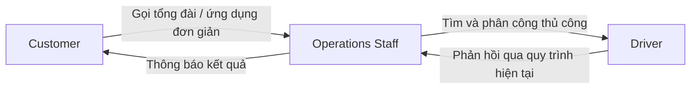
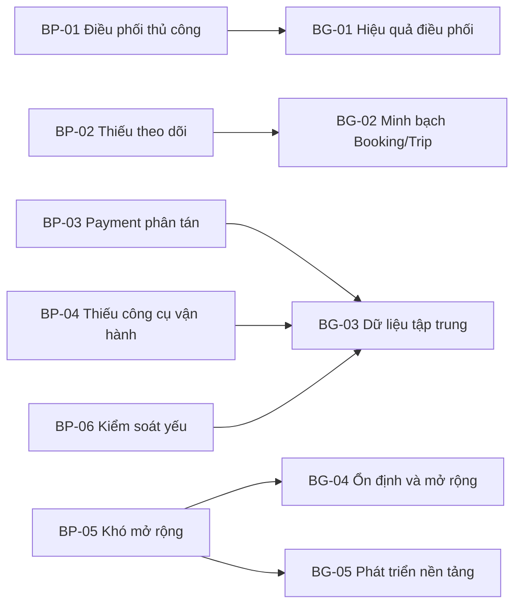
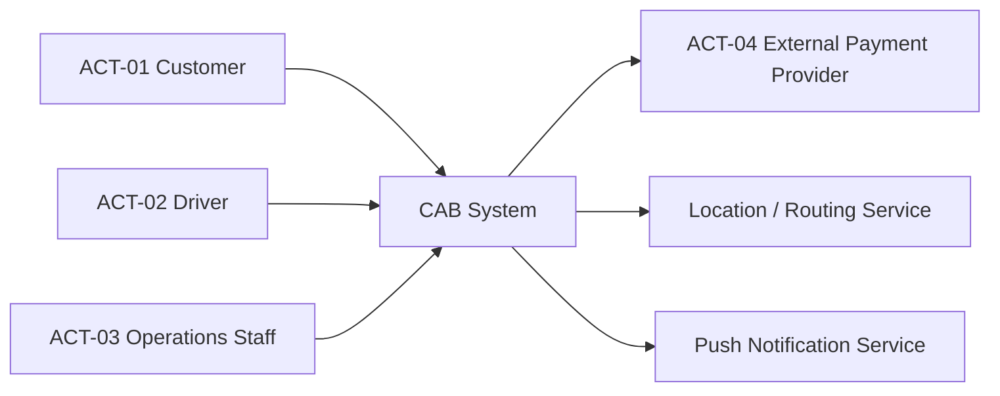
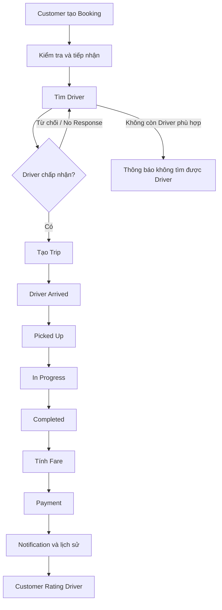
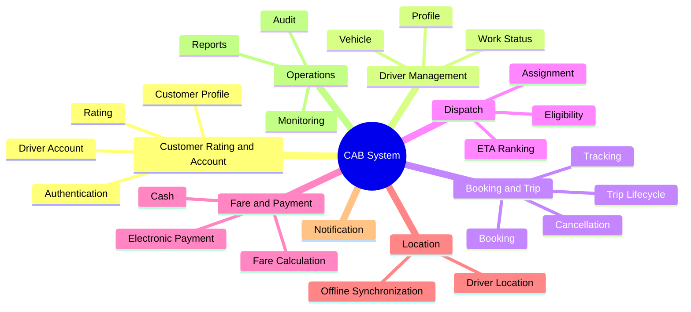
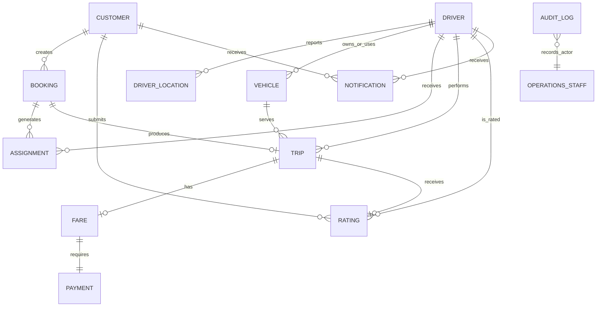
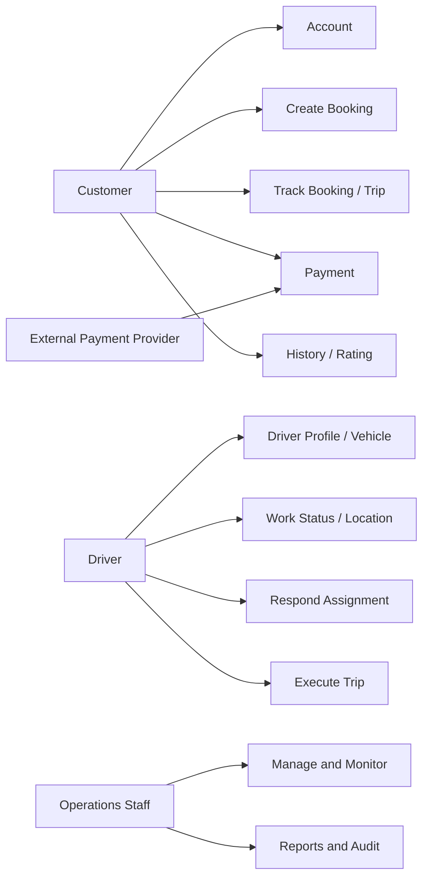

# Software Requirements Specification (SRS)

## CAB System – Nền tảng đặt xe trực tuyến

**Document Version:** 2.2  
**Date:** 09/10/2026  
**Client:** Công ty ABC  
**Project Timeline:** 7 tuần  
**Status:** Hoàn chỉnh – Sẵn sàng bàn giao và nghiệm thu  
**File:** `srs.md`

---

## Mục lục

1. [Giai đoạn 1 – Phân tích yêu cầu sơ khởi](#giai-đoạn-1--phân-tích-yêu-cầu-sơ-khởi)
   - [1.1 Business Context](#11-business-context-ngữ-cảnh-nghiệp-vụ)
   - [1.2 Business Problems](#12-business-problems-vấn-đề-nghiệp-vụ)
   - [1.3 Stakeholders](#13-stakeholders-các-bên-liên-quan)
   - [1.4 Business Goals](#14-business-goals-mục-tiêu-nghiệp-vụ)
   - [1.5 Phạm vi hệ thống](#15-phạm-vi-hệ-thống-scope)
   - [1.6 Business Requirements](#16-business-requirements-yêu-cầu-nghiệp-vụ)
   - [1.7 Business Processes](#17-business-processes-quy-trình-nghiệp-vụ)
2. [Giai đoạn 2 – Phân rã yêu cầu chức năng](#giai-đoạn-2--phân-rã-yêu-cầu-chức-năng)
   - [2.1 Functional Decomposition Tree](#21-functional-decomposition-tree)
   - [2.2 Functional Requirements theo phân hệ](#22-functional-requirements-theo-phân-hệ)
   - [2.3 Function–Actor Matrix](#23-functionactor-matrix)
3. [Giai đoạn 3 – Quy tắc nghiệp vụ và xử lý ngoại lệ](#giai-đoạn-3--quy-tắc-nghiệp-vụ-và-xử-lý-ngoại-lệ)
   - [3.1 Business Rules Catalog](#31-business-rules-catalog)
   - [3.2 Exception Handling & Edge Cases](#32-exception-handling--edge-cases)
   - [3.3 Rule–Exception Traceability Matrix](#33-ruleexception-traceability-matrix)
4. [Giai đoạn 4 – Mô hình dữ liệu nghiệp vụ](#giai-đoạn-4--mô-hình-dữ-liệu-nghiệp-vụ)
   - [4.1 Entity Relationship Diagram](#41-entity-relationship-diagram)
   - [4.2 Data Dictionary logic](#42-data-dictionary-logic)
   - [4.3 Cardinality và toàn vẹn](#43-cardinality-và-toàn-vẹn)
   - [4.4 Data Retention](#44-data-retention)
5. [Giai đoạn 5 – Yêu cầu phi chức năng](#giai-đoạn-5--yêu-cầu-phi-chức-năng)
   - [5.1 NFR Catalog](#51-nfr-catalog)
   - [5.2 External Interface Requirements](#52-external-interface-requirements)
   - [5.3 NFR–Business Goal Traceability](#53-nfrbusiness-goal-traceability)
6. [Giai đoạn 6 – Mô hình hóa Use Case](#giai-đoạn-6--mô-hình-hóa-use-case)
   - [6.1 Actor Catalog](#61-actor-catalog)
   - [6.2 System-Level Use Case Diagram](#62-system-level-use-case-diagram)
   - [6.3 Use Case theo Actor](#63-use-case-theo-actor)
   - [6.4 Use Case Specifications](#64-use-case-specifications)
7. [Giai đoạn 7 – Tiêu chí chấp nhận](#giai-đoạn-7--tiêu-chí-chấp-nhận)
   - [7.1 Nguyên tắc](#71-nguyên-tắc)
   - [7.2 Acceptance Criteria theo phân hệ](#72-acceptance-criteria-theo-phân-hệ)
   - [7.3 AC–FR Matrix](#73-acfr-matrix)
8. [Giai đoạn 8 – Ma trận truy xuất yêu cầu](#giai-đoạn-8--ma-trận-truy-xuất-yêu-cầu)
   - [8.1 Chuỗi truy xuất](#81-chuỗi-truy-xuất)
   - [8.2 Requirements Traceability Matrix](#82-requirements-traceability-matrix)
   - [8.3 NFR/EIR Traceability](#83-nfreir-traceability)
9. [Rủi ro dự án](#rủi-ro-dự-án)
10. [Phụ lục A – Tham chiếu nguồn](#phụ-lục-a--tham-chiếu-nguồn)

---

## Thông tin và quy ước tài liệu

### Mục đích và đối tượng sử dụng

Tài liệu này xác định phạm vi, hành vi nghiệp vụ, yêu cầu chức năng, yêu cầu phi chức năng, dữ liệu logic, use case, tiêu chí chấp nhận và khả năng truy xuất của CAB Core Ride-Hailing MVP. Đây là tài liệu chung để stakeholder review, nhóm phát triển triển khai và nhóm kiểm thử xây dựng Test Case.

SRS mô tả **hệ thống phải đạt gì**. Cách chia bounded context, microservice, API, cơ sở dữ liệu vật lý và công nghệ triển khai được xác định ở các tài liệu downstream.

### Lịch sử phiên bản

| Phiên bản | Ngày | Nội dung |
| --- | --- | --- |
| 2.2 | 09/10/2026 | Tinh giản chính sách nghiệp vụ chưa được Customer Requirement quy định; giữ nguyên phạm vi, cấu trúc yêu cầu và các quyết định kỹ thuật đã chốt. |
| 2.1 | 01/10/2026 | Hoàn chỉnh phạm vi MVP, yêu cầu, use case, AC và RTM. |

### Nguồn yêu cầu

| Tài liệu | Vai trò |
| --- | --- |
| `Customer-Requirement.docx` | Nguồn yêu cầu nghiệp vụ có thẩm quyền. |
| Xác nhận stakeholder trong quá trình phân tích | Chốt phạm vi MVP và nguyên tắc tính cước theo đơn giá/km; các giá trị vận hành còn lại được quản lý bằng cấu hình. |
| `Thiết Kế Micro-Service (1).docx` | Tài liệu tham khảo cho Microservice Design; không phải nguồn tạo yêu cầu SRS. |

Chuỗi tài liệu: **Customer Requirement → SRS → Microservice Design → API Specification → Test Case → Code**.

### Thuật ngữ cốt lõi

| Thuật ngữ | Định nghĩa |
| --- | --- |
| CAB System | Hệ thống/nền tảng đặt xe của Công ty ABC. |
| Customer | Người sử dụng dịch vụ đặt xe. |
| Driver | Tài xế cung cấp dịch vụ vận chuyển. |
| Operations Staff | Nhân viên ABC thực hiện nghiệp vụ hỗ trợ hoặc quản lý vận hành. |
| External Payment Provider | Hệ thống bên ngoài xử lý thanh toán điện tử. |
| Booking | Yêu cầu đặt xe do Customer tạo để tìm Driver. |
| Assignment | Đề nghị và kết quả phân công một Driver cho Booking. |
| Trip | Chuyến đi được tạo sau khi Driver chấp nhận Booking. |
| Fare | Số tiền phải trả cho Trip. |
| Payment | Bản ghi theo dõi phương thức và kết quả thanh toán Fare. |

`Booking` và `Trip` là hai đối tượng khác nhau. CAB System là hệ thống được đặc tả, không phải actor.

### Quy ước ID

Các ID dùng dạng `<PREFIX>-<NN>`: `BG`, `BR`, `BRULE`, `FR`, `NFR`, `ACT`, `UC`, `EX`, `EIR`, `AC`, `CON`, `RISK`.

---

## Giai đoạn 1 – Phân tích yêu cầu sơ khởi

### 1.1 Business Context (Ngữ cảnh nghiệp vụ)

#### 1.1.1 Giới thiệu doanh nghiệp

Công ty ABC cung cấp dịch vụ đặt xe trực tuyến. Hiện tại Customer có thể liên hệ tổng đài hoặc sử dụng một ứng dụng đơn giản để yêu cầu xe. ABC đã có Customer, Driver và Operations Staff nhưng quy trình chưa được số hóa xuyên suốt.

#### 1.1.2 Hiện trạng AS-IS

Đặc điểm chính:

- Điều phối Driver chủ yếu được thực hiện thủ công.
- Customer khó theo dõi trạng thái xử lý và tiến trình Trip.
- Thông tin Payment chưa được quản lý tập trung.
- Operations Staff thiếu công cụ giám sát và báo cáo thống nhất.
- Hệ thống khó mở rộng khi nhu cầu tăng hoặc cần bổ sung chức năng.

#### 1.1.3 Trạng thái TO-BE

CAB System số hóa quy trình **Booking → Dispatch → Trip → Fare → Payment → Notification → Rating**, đồng thời cung cấp dữ liệu vận hành và báo cáo cho ABC.

### 1.2 Business Problems (Vấn đề nghiệp vụ)

| ID | Vấn đề | Tác động | Kỳ vọng |
| --- | --- | --- | --- |
| BP-01 | Phân công Driver chủ yếu thủ công | Thời gian xử lý phụ thuộc Operations Staff và khó mở rộng khi số Booking tăng. | Tự động tìm, ưu tiên và phân công Driver phù hợp. |
| BP-02 | Customer khó theo dõi Booking và Trip | Customer không biết hệ thống đang tìm Driver, Driver nào nhận hoặc Trip đang ở trạng thái nào. | Cung cấp trạng thái, thông tin Driver, ETA và tiến trình Trip. |
| BP-03 | Thông tin thanh toán chưa được quản lý tập trung | Khó tra cứu kết quả giao dịch và tổng hợp doanh thu. | Ghi nhận Fare và Payment tập trung, hỗ trợ tiền mặt và điện tử. |
| BP-04 | Bộ phận vận hành thiếu công cụ quản lý | Khó theo dõi Driver, phương tiện, Trip lỗi, giao dịch và báo cáo. | Cung cấp giao diện Operations và báo cáo hoạt động. |
| BP-05 | Hệ thống hiện tại khó mở rộng | Nhu cầu tăng hoặc thay đổi chức năng có thể ảnh hưởng toàn bộ hệ thống. | Xây dựng CAB System ổn định và có kiến trúc đủ linh hoạt cho phát triển tương lai. |
| BP-06 | Kiểm soát truy cập và dữ liệu chưa đầy đủ | Dữ liệu cá nhân, vị trí, giao dịch và thao tác quan trọng có nguy cơ không được kiểm soát. | Xác thực, phân quyền, bảo vệ dữ liệu và lưu audit. |

### 1.3 Stakeholders (Các bên liên quan)

| Stakeholder | Vai trò và nhu cầu | Mức ảnh hưởng |
| --- | --- | --- |
| Công ty ABC / Ban lãnh đạo | Phê duyệt phạm vi; theo dõi hiệu quả hoạt động và báo cáo. | Cao |
| Customer | Tạo Booking, theo dõi Trip, thanh toán, lịch sử và Rating. | Cao |
| Driver | Quản lý hồ sơ/phương tiện, nhận Assignment và thực hiện Trip. | Cao |
| Operations Staff | Quản lý dữ liệu, giám sát, hỗ trợ, báo cáo và audit theo quyền. | Cao |
| External Payment Provider | Xử lý thanh toán điện tử và trả kết quả. | Trung bình |
| Nhóm phát triển và kiểm thử | Thiết kế, triển khai và xác minh hệ thống theo SRS. | Trung bình |

#### 1.3.1 Power/Interest Matrix

| Nhóm | Stakeholder | Cách phối hợp |
| --- | --- | --- |
| Manage Closely | Công ty ABC, Operations Staff | Review phạm vi, quy trình, chính sách và kết quả nghiệm thu. |
| Keep Informed | Customer, Driver | Thu thập phản hồi về luồng sử dụng và ngoại lệ. |
| Coordinate | Nhóm phát triển, kiểm thử, External Payment Provider | Làm rõ hợp đồng giao tiếp và kết quả cần kiểm chứng. |

### 1.4 Business Goals (Mục tiêu nghiệp vụ)

| ID | Mục tiêu | Nguồn |
| --- | --- | --- |
| BG-01 | Tự động hóa và nâng cao hiệu quả điều phối giữa Customer, Driver và Operations Staff. | P003, P006, P014 |
| BG-02 | Cho phép Customer theo dõi minh bạch quá trình xử lý Booking và thực hiện Trip. | P003, P004, P008 |
| BG-03 | Tập trung dữ liệu nghiệp vụ và giao dịch để phục vụ vận hành, kiểm tra và báo cáo. | P003, P009, P014 |
| BG-04 | Duy trì dịch vụ ổn định khi nhu cầu tăng và cho phép mở rộng từng năng lực độc lập. | P003, P010 |
| BG-05 | Tạo nền tảng có thể bổ sung dịch vụ, phương thức thanh toán và kênh thông báo mà không phải xây dựng lại toàn bộ ứng dụng. | P008, P010, P012 |

#### 1.4.1 Bản đồ liên kết vấn đề – mục tiêu

### 1.5 Phạm vi hệ thống (Scope)

#### 1.5.1 Trong phạm vi – CAB Core Ride-Hailing MVP

| Module | Năng lực | Phạm vi | Ưu tiên |
| --- | --- | --- | --- |
| 1.0 | Customer, Rating & tài khoản | Đăng ký, đăng nhập, khôi phục mật khẩu, cập nhật hồ sơ Customer và đánh giá Driver sau Trip hoàn thành. | Must |
| 2.0 | Driver & phương tiện | Tự đăng ký/được tạo, nộp hồ sơ, xét duyệt, cập nhật phương tiện và trạng thái làm việc. | Must |
| 3.0 | Booking & Trip | Tạo Booking, theo dõi, hủy, thực hiện Trip và xem lịch sử. | Must |
| 4.0 | Điều phối | Lọc, xếp hạng và gửi Assignment tuần tự; xử lý từ chối, timeout và không tìm được Driver. | Must |
| 5.0 | Fare & Payment | Tính cước theo loại dịch vụ/quãng đường; tiền mặt và một External Payment Provider. | Must |
| 6.0 | Location | Nhận và lưu vị trí Driver; hỗ trợ tìm Driver gần Customer và ước tính ETA. | Must |
| 7.0 | Notification | Thông báo tại các mốc nghiệp vụ bắt buộc và hỗ trợ mở rộng kênh thông báo. | Must |
| 8.0 | Operations & Reporting | Quản lý, giám sát, hỗ trợ và cung cấp báo cáo nghiệp vụ cơ bản. | Must |
| 9.0 | Security & Audit | Xác thực, phân quyền, bảo vệ dữ liệu, audit và lưu trữ. | Must |

MVP sử dụng giao diện web tối ưu cho thiết bị di động đối với Customer và Driver, cùng giao diện web trên máy tính cho Operations Staff.

#### 1.5.2 Ngoài phạm vi MVP

| ID | Nội dung | Lý do |
| --- | --- | --- |
| OS-01 | Ứng dụng mobile native | MVP sử dụng giao diện web tối ưu cho thiết bị di động. |
| OS-02 | Đặt xe trước | MVP chỉ hỗ trợ Booking tức thời. |
| OS-03 | Ghép chuyến hoặc đi chung | Không thuộc quy trình cốt lõi được nguồn yêu cầu. |
| OS-04 | Nhiều điểm dừng | MVP sử dụng một điểm đón và một điểm đến. |
| OS-05 | Dynamic pricing, phí thời gian và phí đặt xe | MVP dùng đơn giá cố định theo km. |
| OS-06 | Khuyến mại, voucher và loyalty | Không được Customer Requirement yêu cầu. |
| OS-07 | Ví nội bộ | MVP dùng tiền mặt và External Payment Provider. |
| OS-08 | Nhiều Payment Provider đồng thời | MVP tích hợp một External Payment Provider. |
| OS-09 | AI Dispatch và dự báo nhu cầu | Không cần thiết cho bài thực hành và không có trong nguồn. |
| OS-10 | Báo cáo BI nâng cao | MVP chỉ cần báo cáo nghiệp vụ cơ bản. |

#### 1.5.3 System Boundary

CAB System sở hữu dữ liệu Booking, Assignment, Trip, Fare, trạng thái Payment, Rating và dữ liệu vận hành. External Payment Provider xử lý dữ liệu thanh toán nhạy cảm.

#### 1.5.4 Constraints

| ID | Ràng buộc | Nguồn |
| --- | --- | --- |
| CON-01 | Xây dựng và triển khai sản phẩm trong 7 tuần. | P002 |
| CON-02 | Không lưu trực tiếp thông tin nhạy cảm của thẻ hoặc tài khoản thanh toán. | P007 |
| CON-03 | Customer và Driver phải được xác thực trước khi dùng chức năng yêu cầu tài khoản. | P011 |
| CON-04 | Thao tác quản trị phải được kiểm soát quyền. | P009, P011 |
| CON-05 | Thông tin cá nhân, phương tiện, vị trí và giao dịch phải được bảo vệ. | P011 |
| CON-06 | Các thao tác quan trọng phải được lưu vết. | P011 |

### 1.6 Business Requirements (Yêu cầu nghiệp vụ)

#### 1.6.1 Tài khoản và Driver

| ID | Yêu cầu nghiệp vụ | Mục tiêu | Nguồn |
| --- | --- | --- | --- |
| BR-01 | CAB System phải hỗ trợ Customer đăng ký, đăng nhập và cập nhật thông tin cá nhân. | BG-01, BG-03 | P004 |
| BR-02 | CAB System phải hỗ trợ Driver tự đăng ký hoặc được Operations Staff tạo tài khoản; quản lý hồ sơ, phương tiện và trạng thái làm việc. | BG-01, BG-03 | P005 |
| BR-18 | Customer và Driver phải được xác thực trước khi sử dụng chức năng yêu cầu tài khoản. | BG-03 | P011 |

#### 1.6.2 Booking, Dispatch và Trip

| ID | Yêu cầu nghiệp vụ | Mục tiêu | Nguồn |
| --- | --- | --- | --- |
| BR-03 | CAB System phải cho phép Customer tạo Booking với điểm đón, điểm đến và loại dịch vụ. | BG-01 | P004 |
| BR-04 | CAB System phải tìm và ưu tiên Driver phù hợp dựa trên điều kiện hoạt động, loại dịch vụ, vị trí và ETA. | BG-01 | P005, P006 |
| BR-05 | CAB System phải tiếp tục tìm Driver trên cùng Booking khi Driver từ chối hoặc không phản hồi và thông báo rõ khi không tìm được Driver. | BG-01, BG-02 | P006 |
| BR-06 | CAB System phải hỗ trợ Driver tiếp nhận yêu cầu và cập nhật đầy đủ tiến trình Trip. | BG-01 | P005 |
| BR-07 | CAB System phải cung cấp cho Customer trạng thái Booking, thông tin Driver, ETA, trạng thái Trip, lịch sử và số tiền phải trả. | BG-02, BG-03 | P004 |

#### 1.6.3 Fare, Payment, Notification và Rating

| ID | Yêu cầu nghiệp vụ | Mục tiêu | Nguồn |
| --- | --- | --- | --- |
| BR-08 | CAB System phải xác định cước sau khi Trip hoàn thành theo loại dịch vụ và quãng đường thực tế. | BG-01, BG-03 | P007 |
| BR-09 | CAB System phải hỗ trợ tiền mặt và thanh toán điện tử qua External Payment Provider, bao gồm xử lý giao dịch thất bại. | BG-01, BG-03 | P007 |
| BR-10 | CAB System phải thông báo cho Customer và Driver tại các mốc nghiệp vụ đã xác định. | BG-01, BG-02 | P008 |
| BR-11 | CAB System phải cho phép Customer đánh giá Driver sau khi Trip hoàn thành. | BG-02 | P004 |

#### 1.6.4 Operations và báo cáo

| ID | Yêu cầu nghiệp vụ | Mục tiêu | Nguồn |
| --- | --- | --- | --- |
| BR-12 | CAB System phải cung cấp giao diện để Operations Staff quản lý dữ liệu, giám sát hoạt động và xử lý ngoại lệ. | BG-01, BG-03 | P009 |
| BR-13 | CAB System phải cho phép Operations Staff tra cứu lịch sử giao dịch và audit log theo quyền. | BG-03 | P009, P011 |
| BR-14 | CAB System phải cung cấp báo cáo hoạt động theo ngày và tháng. | BG-03 | P009, P014 |

#### 1.6.5 Chất lượng, bảo mật và phát triển nền tảng

| ID | Yêu cầu nghiệp vụ | Mục tiêu | Nguồn |
| --- | --- | --- | --- |
| BR-15 | Lỗi thanh toán hoặc thông báo không được làm ngừng chức năng đặt xe và thực hiện Trip. | BG-04 | P010 |
| BR-16 | Các năng lực có tải khác nhau phải có khả năng mở rộng và triển khai độc lập. | BG-04, BG-05 | P010 |
| BR-17 | CAB System phải cho phép mở rộng loại dịch vụ, thanh toán và thông báo với ảnh hưởng hạn chế. | BG-05 | P008, P010, P012 |
| BR-19 | Thao tác quản trị phải được kiểm soát theo quyền được cấp cho Operations Staff. | BG-03 | P009, P011 |
| BR-20 | Thông tin cá nhân, phương tiện, vị trí và giao dịch phải được bảo vệ; CAB System không lưu thông tin thanh toán nhạy cảm. | BG-03 | P007, P011 |
| BR-21 | Các thao tác quan trọng phải được lưu vết để phục vụ kiểm tra sự cố. | BG-03 | P011 |

### 1.7 Business Processes (Quy trình nghiệp vụ)

#### 1.7.1 End-to-End Business Flow

#### 1.7.2 BP-01 – Driver Onboarding

1. Driver tự đăng ký hoặc Operations Staff tạo tài khoản.
2. Hồ sơ và phương tiện được nộp ở `Pending Verification`.
3. Operations Staff có quyền cập nhật trạng thái hồ sơ và ghi nhận lý do.
4. Driver `Active` được phép chuyển sang `Available`.

#### 1.7.3 BP-02 – Booking và Driver Matching

1. Customer nhập điểm đón, điểm đến và loại dịch vụ.
2. CAB System tạo Booking `Searching`.
3. Hệ thống lọc Driver hợp lệ, tính ETA và xếp hạng.
4. Assignment được gửi cho Driver theo thứ tự ưu tiên; thời hạn phản hồi lấy từ cấu hình vận hành.
5. Driver đầu tiên chấp nhận hợp lệ được gán Booking.
6. Tìm kiếm kết thúc khi có Driver chấp nhận hoặc không còn Driver phù hợp theo cấu hình vận hành.

#### 1.7.4 BP-03 – Trip Execution

Driver cập nhật tuần tự: `Driver Assigned → Driver Arrived → Picked Up → In Progress → Completed`. CAB System thông báo Customer tại các mốc bắt buộc.

#### 1.7.5 BP-04 – Fare và Payment

Sau `Completed`, CAB System tính Fare theo loại dịch vụ và quãng đường. Customer chọn tiền mặt hoặc điện tử. Thanh toán điện tử thất bại được thông báo để Customer thực hiện lại hoặc chọn tiền mặt.

#### 1.7.6 BP-05 – Cancellation

Customer hoặc Driver được hủy trước `Picked Up` và ghi nhận lý do. Sau `Picked Up`, Operations Staff có quyền xử lý trường hợp Trip gặp sự cố.

#### 1.7.7 BP-06 – Operations và Reporting

Operations Staff tra cứu Customer, Driver, Vehicle, Booking, Trip và Payment; giám sát Trip đang diễn ra; hỗ trợ ngoại lệ; xem báo cáo theo ngày/tháng trong phạm vi quyền.

---

## Giai đoạn 2 – Phân rã yêu cầu chức năng

### 2.1 Functional Decomposition Tree

### 2.2 Functional Requirements theo phân hệ

#### 2.2.1 Phân hệ 1.0: Customer, Rating & Tài khoản

| ID | Yêu cầu chức năng | Chủ thể/Thực thi | Ưu tiên | BR |
| --- | --- | --- | --- | --- |
| FR-01 | Cho phép Customer đăng ký bằng số điện thoại, mật khẩu và OTP xác minh. | Customer | Must | BR-01, BR-18 |
| FR-02 | Cho phép Customer và Driver đăng nhập bằng số điện thoại và mật khẩu. | Customer, Driver | Must | BR-01, BR-02, BR-18 |
| FR-03 | Cho phép Customer và Driver khôi phục mật khẩu bằng OTP. | Customer, Driver | Must | BR-01, BR-02, BR-18 |
| FR-04 | Cho phép Customer cập nhật thông tin cá nhân của mình. | Customer | Must | BR-01 |
| FR-47 | Cho phép Customer gửi một Rating 1–5 sao kèm nhận xét sau khi Trip hoàn thành. | Customer | Must | BR-11 |
| FR-48 | Hiển thị điểm đánh giá trung bình của Driver từ các đánh giá hợp lệ. | Tự động | Must | BR-11, BR-14 |

#### 2.2.2 Phân hệ 2.0: Quản lý Driver & Phương tiện

| ID | Yêu cầu chức năng | Chủ thể/Thực thi | Ưu tiên | BR |
| --- | --- | --- | --- | --- |
| FR-05 | Cho phép Driver tự đăng ký sau khi xác minh số điện thoại bằng OTP và nộp hồ sơ xác minh. | Driver | Must | BR-02 |
| FR-06 | Cho phép Operations Staff tạo tài khoản và hồ sơ Driver. | Operations Staff | Must | BR-02, BR-12 |
| FR-07 | Cho phép Operations Staff có quyền cập nhật trạng thái hồ sơ Driver và ghi nhận lý do. | Operations Staff | Must | BR-02, BR-12, BR-19 |
| FR-08 | Cho phép Driver cập nhật hồ sơ và phương tiện; thay đổi thông tin cần xác minh đưa hồ sơ về `Pending Verification`. | Driver | Must | BR-02 |
| FR-09 | Cho phép Driver `Active` chuyển giữa `Offline` và `Available` khi không có Trip. | Driver | Must | BR-02 |

#### 2.2.3 Phân hệ 3.0: Booking & Vòng đời Trip

| ID | Yêu cầu chức năng | Chủ thể/Thực thi | Ưu tiên | BR |
| --- | --- | --- | --- | --- |
| FR-10 | Cho phép Customer nhập điểm đón, điểm đến và chọn `Bike`, `Car 4-seat` hoặc `Car 7-seat`. | Customer | Must | BR-03 |
| FR-11 | Cho phép Customer gửi Booking và nhận mã Booking duy nhất. | Customer | Must | BR-03 |
| FR-20 | Hiển thị cho Customer trạng thái tìm Driver, Driver được gán và ETA. | Customer | Must | BR-07 |
| FR-21 | Cho phép Customer theo dõi trạng thái Trip đang thực hiện. | Customer | Must | BR-07 |
| FR-22 | Trả Driver về `Available` sau từ chối, hết hạn hoặc hủy nếu Driver vẫn đang làm việc và không có Trip khác. | Tự động | Must | BR-02, BR-05 |
| FR-25 | Cho phép Driver cập nhật `Driver Arrived`. | Driver | Must | BR-06 |
| FR-26 | Cho phép Driver cập nhật `Picked Up`. | Driver | Must | BR-06 |
| FR-27 | Cho phép Driver cập nhật `In Progress`. | Driver | Must | BR-06 |
| FR-28 | Cho phép Driver cập nhật `Completed` và kích hoạt tính cước. | Driver | Must | BR-06, BR-08 |
| FR-29 | Cho phép Customer hủy trước `Picked Up` và ghi nhận lý do. | Customer | Must | BR-03, BR-07 |
| FR-30 | Cho phép Driver từ chối Assignment hoặc yêu cầu hủy trước `Picked Up` và ghi nhận lý do. | Driver | Must | BR-06 |
| FR-31 | Cho phép Operations Staff có quyền xử lý Trip gặp sự cố sau `Picked Up` và ghi nhận lý do. | Operations Staff | Must | BR-12, BR-19 |
| FR-46 | Cho phép Customer xem lịch sử Trip và chi tiết cước/thanh toán của mình. | Customer | Must | BR-07 |

#### 2.2.4 Phân hệ 4.0: Tìm & Phân công Driver

| ID | Yêu cầu chức năng | Chủ thể/Thực thi | Ưu tiên | BR |
| --- | --- | --- | --- | --- |
| FR-12 | Lọc danh sách Driver đủ điều kiện cho loại dịch vụ của Booking. | Tự động | Must | BR-04 |
| FR-13 | Tính ETA đến điểm đón và xếp hạng Driver theo chính sách ưu tiên. | Tự động | Must | BR-04 |
| FR-14 | Gửi đề nghị nhận Booking tuần tự cho Driver theo thứ tự ưu tiên. | Tự động | Must | BR-04, BR-05, BR-10 |
| FR-15 | Cho phép Driver chấp nhận hoặc từ chối Assignment trong thời hạn phản hồi được cấu hình. | Driver | Must | BR-06 |
| FR-16 | Ghi nhận `No Response` khi Driver không phản hồi và tiếp tục với Driver tiếp theo. | Tự động | Must | BR-05 |
| FR-17 | Bảo đảm chỉ phản hồi chấp nhận hợp lệ đầu tiên được gán Booking. | Tự động | Must | BR-04, BR-06 |
| FR-18 | Kết thúc tìm Driver khi không còn Driver phù hợp hoặc đạt điều kiện kết thúc được cấu hình. | Tự động | Must | BR-05 |
| FR-19 | Thông báo Customer khi không tìm được Driver và chuyển Booking sang `No Driver Available`. | Tự động | Must | BR-05, BR-10 |

#### 2.2.5 Phân hệ 5.0: Tính cước & Thanh toán

| ID | Yêu cầu chức năng | Chủ thể/Thực thi | Ưu tiên | BR |
| --- | --- | --- | --- | --- |
| FR-33 | Xác định quãng đường tính cước của Trip đã hoàn thành. | Tự động | Must | BR-08 |
| FR-34 | Áp dụng đơn giá/km tương ứng với loại dịch vụ để tính Fare. | Tự động | Must | BR-08 |
| FR-35 | Lưu loại dịch vụ, quãng đường tính cước, đơn giá/km và tổng Fare của Trip. | Tự động | Must | BR-07, BR-08 |
| FR-36 | Cho phép Customer chọn tiền mặt hoặc thanh toán điện tử sau khi cước được xác định. | Customer | Must | BR-09 |
| FR-37 | Gửi yêu cầu thanh toán điện tử tới External Payment Provider mà không lưu dữ liệu thanh toán nhạy cảm. | Tự động | Must | BR-09, BR-20 |
| FR-38 | Tiếp nhận và đối soát kết quả thanh toán điện tử theo mã tham chiếu duy nhất. | Tự động | Must | BR-09 |
| FR-39 | Thông báo Customer khi thanh toán điện tử thành công hoặc thất bại. | Tự động | Must | BR-09, BR-10 |
| FR-40 | Cho phép Customer thực hiện lại thanh toán điện tử sau khi giao dịch thất bại. | Customer | Must | BR-09 |
| FR-41 | Cho phép chuyển từ thanh toán điện tử thất bại sang tiền mặt. | Customer | Must | BR-09 |
| FR-42 | Cho phép Driver xác nhận đã thu tiền mặt và Operations Staff có quyền hỗ trợ Payment ngoại lệ. | Driver, Operations Staff | Must | BR-09, BR-12, BR-19 |

#### 2.2.6 Phân hệ 6.0: Định vị & Theo dõi

| ID | Yêu cầu chức năng | Chủ thể/Thực thi | Ưu tiên | BR |
| --- | --- | --- | --- | --- |
| FR-23 | Tiếp nhận và lưu vị trí Driver khi Driver sẵn sàng hoặc đang thực hiện Trip. | Driver | Must | BR-04, BR-07 |
| FR-24 | Kiểm tra độ mới của vị trí theo cấu hình trước khi dùng để tìm Driver hoặc tính ETA. | Tự động | Must | BR-04 |
| FR-32 | Lưu tạm và đồng bộ cập nhật vị trí/trạng thái khi thiết bị kết nối lại. | Tự động | Must | BR-06, BR-07, BR-15 |

#### 2.2.7 Phân hệ 7.0: Thông báo

| ID | Yêu cầu chức năng | Chủ thể/Thực thi | Ưu tiên | BR |
| --- | --- | --- | --- | --- |
| FR-43 | Gửi thông báo Customer khi Booking được tiếp nhận, Driver nhận, Driver đến, Trip hoàn thành và Payment có kết quả. | Tự động | Must | BR-10 |
| FR-44 | Gửi Driver thông báo về Booking mới và thay đổi của Trip được gán. | Tự động | Must | BR-10 |
| FR-45 | Ghi nhận lỗi gửi và thực hiện lại theo cấu hình đối với lỗi tạm thời mà không đảo giao dịch nguồn. | Tự động | Must | BR-10, BR-15 |

#### 2.2.8 Phân hệ 8.0: Vận hành & Báo cáo

| ID | Yêu cầu chức năng | Chủ thể/Thực thi | Ưu tiên | BR |
| --- | --- | --- | --- | --- |
| FR-49 | Cho phép Operations Staff tìm kiếm và xem Customer, Driver, phương tiện, Booking, Trip và Payment theo quyền. | Operations Staff | Must | BR-12, BR-13, BR-19 |
| FR-50 | Cho phép Operations Staff cập nhật thông tin hỗ trợ và ghi chú xử lý trong phạm vi quyền được cấp. | Operations Staff | Must | BR-12, BR-19 |
| FR-51 | Cho phép Operations Staff xem Trip đang diễn ra và thời điểm cập nhật cuối của Driver. | Operations Staff | Must | BR-12 |
| FR-52 | Cho phép Operations Staff tra cứu lịch sử giao dịch và trạng thái Payment. | Operations Staff | Must | BR-13 |
| FR-53 | Cho phép Operations Staff có quyền quản lý đơn giá/km theo loại dịch vụ; thay đổi không tính lại Fare đã xác định. | Operations Staff | Must | BR-08, BR-12, BR-19 |
| FR-54 | Cung cấp báo cáo số lượng Booking và Trip theo khoảng thời gian, trạng thái và loại dịch vụ. | Operations Staff | Must | BR-14 |
| FR-55 | Cung cấp báo cáo doanh thu từ các Payment đã được ghi nhận thành công theo khoảng thời gian. | Operations Staff | Must | BR-14 |
| FR-56 | Cung cấp tỷ lệ Trip hoàn thành theo khoảng thời gian và điều kiện lọc. | Operations Staff | Must | BR-14 |
| FR-57 | Cung cấp tỷ lệ Booking hoặc Trip bị hủy theo khoảng thời gian và điều kiện lọc. | Operations Staff | Must | BR-14 |
| FR-58 | Cung cấp báo cáo hiệu quả hoạt động của Driver từ dữ liệu Trip và Rating đã ghi nhận. | Operations Staff | Must | BR-14 |

#### 2.2.9 Phân hệ 9.0: Phân quyền, Audit & Lưu trữ

| ID | Yêu cầu chức năng | Chủ thể/Thực thi | Ưu tiên | BR |
| --- | --- | --- | --- | --- |
| FR-59 | Kiểm soát quyền cho mọi chức năng và giao diện Operations. | Tự động | Must | BR-19 |
| FR-60 | Lưu audit cho duyệt Driver, thay đổi giá, hủy/kết thúc vận hành, xử lý Payment và thay đổi quyền. | Tự động | Must | BR-21 |
| FR-61 | Cho phép Operations Staff có quyền tìm kiếm audit log nhưng không sửa hoặc xóa qua chức năng nghiệp vụ. | Operations Staff | Must | BR-13, BR-19, BR-21 |
| FR-62 | Áp dụng chính sách lưu trữ được cấu hình và phê duyệt cho từng nhóm dữ liệu. | Tự động | Must | BR-20, BR-21 |

### 2.3 Function–Actor Matrix

| Phân hệ | Customer | Driver | Operations Staff | External Payment Provider |
| --- | :---: | :---: | :---: | :---: |
| 1.0 Customer, Rating & tài khoản | ✓ | ✓ / Được đánh giá | Theo quyền |  |
| 2.0 Driver & Vehicle |  | ✓ | ✓ |  |
| 3.0 Booking & Trip | ✓ | ✓ | ✓ |  |
| 4.0 Dispatch | Theo dõi | Phản hồi | Giám sát |  |
| 5.0 Fare & Payment | ✓ | Xác nhận Cash | Theo quyền | ✓ |
| 6.0 Location | Theo dõi | Cung cấp | Giám sát |  |
| 7.0 Notification | Nhận | Nhận |  |  |
| 8.0 Operations & Reports |  |  | ✓ |  |
| 9.0 Security & Audit |  |  | ✓ |  |
### 2.4 Thống kê phân rã

- 9 phân hệ chức năng.
- 62 Functional Requirements.
- Tất cả FR thuộc MVP có ưu tiên Must.
- Mỗi FR được liên kết với BR, Use Case, Acceptance Criteria và Test Suite tại RTM.

---

## Giai đoạn 3 – Quy tắc nghiệp vụ và xử lý ngoại lệ

### 3.1 Business Rules Catalog

#### BRULE-01: Driver Verification

| Thuộc tính | Nội dung |
| --- | --- |
| Quy tắc | Driver có thể tự đăng ký hoặc được Operations Staff tạo. Driver chỉ được nhận Booking khi hồ sơ và phương tiện đang ở trạng thái được phép hoạt động. |
| Áp dụng | Driver, Operations Staff |
| Yêu cầu liên quan | FR-05–FR-09 |

#### BRULE-02: Service Type và Fare

| Thuộc tính | Nội dung |
| --- | --- |
| Quy tắc | MVP sử dụng đơn giá cố định theo km: Bike 5.000 VNĐ/km, Car 4-seat 10.000 VNĐ/km và Car 7-seat 13.000 VNĐ/km. Fare = quãng đường tính cước × đơn giá/km của loại dịch vụ. |
| Áp dụng | Customer, Driver, Operations Staff |
| Yêu cầu liên quan | FR-10, FR-33–FR-35, FR-53 |

#### BRULE-03: Driver Eligibility

| Thuộc tính | Nội dung |
| --- | --- |
| Quy tắc | Driver được xét khi hồ sơ và phương tiện được phép hoạt động, đúng loại dịch vụ, đang sẵn sàng, không có Trip đang thực hiện và có vị trí đáp ứng ngưỡng độ mới được cấu hình. |
| Áp dụng | Driver; xử lý tự động |
| Yêu cầu liên quan | FR-12, FR-23, FR-24 |

#### BRULE-04: Driver Priority

| Thuộc tính | Nội dung |
| --- | --- |
| Quy tắc | Ưu tiên Driver phù hợp và gần Customer; thứ tự ổn định khi các Driver có kết quả tương đương. |
| Áp dụng | Xử lý tự động |
| Yêu cầu liên quan | FR-13 |

#### BRULE-05: Dispatch Timeout

| Thuộc tính | Nội dung |
| --- | --- |
| Quy tắc | Mỗi Assignment có thời hạn phản hồi theo cấu hình. Nếu Driver từ chối hoặc không phản hồi, hệ thống tiếp tục cùng Booking; chỉ phản hồi chấp nhận hợp lệ đầu tiên được công nhận. |
| Áp dụng | Driver; xử lý tự động |
| Yêu cầu liên quan | FR-14–FR-19 |

#### BRULE-06: Trip Lifecycle

| Thuộc tính | Nội dung |
| --- | --- |
| Quy tắc | Trạng thái phải đi đúng thứ tự; server từ chối bỏ qua, lùi hoặc lặp trạng thái làm thay đổi kết quả. |
| Áp dụng | Driver, Operations Staff |
| Yêu cầu liên quan | FR-25–FR-28, FR-32 |

#### BRULE-07: Cancellation

| Thuộc tính | Nội dung |
| --- | --- |
| Quy tắc | Customer và Driver có thể yêu cầu hủy trước `Picked Up` và phải ghi nhận lý do. Sau `Picked Up`, Operations Staff có quyền xử lý Trip gặp sự cố. |
| Áp dụng | Customer, Driver, Operations Staff |
| Yêu cầu liên quan | FR-29–FR-31 |

#### BRULE-08: Payment

| Thuộc tính | Nội dung |
| --- | --- |
| Quy tắc | Khi thanh toán điện tử thất bại, Customer được thông báo để thực hiện lại hoặc chọn Cash. CAB System không lưu dữ liệu thanh toán nhạy cảm. |
| Áp dụng | Customer, Driver, Operations Staff |
| Yêu cầu liên quan | FR-36–FR-42 |

#### BRULE-09: Location và Offline

| Thuộc tính | Nội dung |
| --- | --- |
| Quy tắc | CAB System ghi nhận vị trí Driver và chỉ dùng dữ liệu đáp ứng ngưỡng độ mới được cấu hình. Mất kết nối không tự động hủy Booking hoặc Trip. |
| Áp dụng | Driver; xử lý tự động |
| Yêu cầu liên quan | FR-23, FR-24, FR-32 |

#### BRULE-10: Rating

| Thuộc tính | Nội dung |
| --- | --- |
| Quy tắc | Customer được gửi một Rating 1–5 kèm nhận xét bắt buộc cho Driver sau khi Trip `Completed`. |
| Áp dụng | Customer |
| Yêu cầu liên quan | FR-47, FR-48 |

#### BRULE-11: Operations Authorization

| Thuộc tính | Nội dung |
| --- | --- |
| Quy tắc | Operations Staff chỉ được thực hiện các chức năng quản lý, hỗ trợ, cấu hình và tra cứu audit phù hợp với quyền được cấp. |
| Áp dụng | Operations Staff |
| Yêu cầu liên quan | FR-07, FR-31, FR-42, FR-49–FR-53, FR-59–FR-61 |

#### BRULE-12: Notification

| Thuộc tính | Nội dung |
| --- | --- |
| Quy tắc | CAB System gửi thông báo tại các mốc nghiệp vụ bắt buộc; lỗi gửi không được đảo hoặc làm thất bại giao dịch nghiệp vụ nguồn. |
| Áp dụng | Xử lý tự động |
| Yêu cầu liên quan | FR-43–FR-45 |

#### BRULE-13: Retention

| Thuộc tính | Nội dung |
| --- | --- |
| Quy tắc | Thời hạn lưu của từng nhóm dữ liệu được cấu hình theo chính sách do ABC phê duyệt và quy định áp dụng; thay đổi thời hạn không yêu cầu sửa logic nghiệp vụ. |
| Áp dụng | Operations Staff; tác vụ lưu trữ tự động |
| Yêu cầu liên quan | FR-62 |

### 3.2 Exception Handling & Edge Cases

| ID | Tình huống | Xử lý | Liên kết |
| --- | --- | --- | --- |
| EX-01 | Dữ liệu đăng ký hoặc Booking thiếu/không hợp lệ | Không lưu giao dịch nghiệp vụ; chỉ rõ trường cần sửa mà không tiết lộ dữ liệu nhạy cảm. | FR-01, FR-05, FR-10, FR-11 |
| EX-02 | Driver từ chối đề nghị | Ghi `Rejected`, trả Driver về trạng thái phù hợp và tiếp tục với Driver kế tiếp. | FR-15, FR-22 |
| EX-03 | Driver không phản hồi trong thời hạn cấu hình | Ghi `No Response` và tiếp tục cùng Booking. | FR-16 |
| EX-04 | Phản hồi chấp nhận muộn hoặc đồng thời | Chỉ phản hồi hợp lệ đầu tiên được nhận; phản hồi còn lại bị từ chối. | FR-17 |
| EX-05 | Không tìm được Driver | Kết thúc khi không còn Driver phù hợp hoặc đạt điều kiện cấu hình; thông báo Customer. | FR-18, FR-19 |
| EX-06 | Customer hoặc Driver hủy trước `Picked Up` | Lưu lý do, giải phóng Driver và thông báo bên còn lại. | FR-29, FR-30 |
| EX-07 | Yêu cầu tự hủy sau `Picked Up` | Từ chối và hướng dẫn liên hệ Operations Staff. | FR-29, FR-30, FR-31 |
| EX-08 | Mất kết nối | Giữ Booking/Trip hiện tại, lưu tạm thao tác và đồng bộ an toàn khi kết nối lại. | FR-24, FR-32 |
| EX-09 | Chuyển trạng thái Trip không hợp lệ | Từ chối cập nhật, giữ trạng thái hiện tại và ghi sự kiện phục vụ kiểm tra. | FR-25–FR-28, NFR-12 |
| EX-10 | Thanh toán điện tử thất bại | Thông báo Customer; cho phép thực hiện lại hoặc chuyển sang tiền mặt. | FR-39–FR-41 |
| EX-11 | Callback thanh toán trùng hoặc đến muộn | Đối soát theo mã tham chiếu, không tạo Payment trùng và không đảo kết quả đã hoàn tất trái quy tắc. | FR-38, NFR-12 |
| EX-12 | Thông báo gửi thất bại | Ghi nhận kết quả, xử lý lại theo cấu hình và không đảo giao dịch nghiệp vụ. | FR-45 |
| EX-13 | Truy cập trái quyền | Từ chối, không trả dữ liệu bị bảo vệ và ghi sự kiện an ninh phù hợp. | FR-49, FR-59, FR-61 |

### 3.3 Rule–Exception Traceability Matrix

| Business Rule | Exception liên quan |
| --- | --- |
| BRULE-01 | EX-01, EX-13 |
| BRULE-03, BRULE-04, BRULE-05 | EX-02, EX-03, EX-04, EX-05 |
| BRULE-06, BRULE-07 | EX-06, EX-07, EX-08, EX-09 |
| BRULE-08 | EX-10, EX-11 |
| BRULE-09 | EX-08 |
| BRULE-11 | EX-13 |
| BRULE-12 | EX-12 |
| BRULE-13 | EX-13 |

---

## Giai đoạn 4 – Mô hình dữ liệu nghiệp vụ

Phần này mô tả dữ liệu ở mức logic phục vụ nghiệp vụ. Schema vật lý, kiểu dữ liệu theo DBMS và index thuộc Microservice Design.

### 4.1 Entity Relationship Diagram

### 4.2 Data Dictionary logic

| Entity | Thuộc tính nghiệp vụ tối thiểu | Quy tắc chính |
| --- | --- | --- |
| Customer | Customer ID, số điện thoại, họ tên, trạng thái, thời điểm tạo/cập nhật | Số điện thoại dùng cho xác thực và không trùng trong nhóm tài khoản áp dụng. |
| Driver | Driver ID, định danh, số điện thoại, giấy phép lái xe, trạng thái xác minh/tài khoản | Chỉ `Active` được làm việc. |
| Vehicle | Vehicle ID, Driver ID, loại dịch vụ, biển số, đăng ký, bảo hiểm, trạng thái hiệu lực | Phải hợp lệ và phù hợp loại dịch vụ. |
| Driver Location | Driver ID, tọa độ, thời điểm thiết bị, thời điểm hệ thống nhận | Chỉ dữ liệu đáp ứng ngưỡng độ mới được cấu hình mới được dùng tìm Driver. |
| Booking | Booking ID, Customer ID, điểm đón/đến, loại dịch vụ, trạng thái, thời điểm | Tồn tại trước Trip. |
| Assignment | Assignment ID, Booking ID, Driver ID, thứ tự, thời điểm gửi/hết hạn/phản hồi, kết quả | Một Booking có nhiều Assignment nhưng tối đa một Accepted. |
| Trip | Trip ID, Booking ID, Driver ID, Vehicle ID, trạng thái, mốc thời gian, quãng đường | Một Booking có tối đa một Trip thực hiện. |
| Fare | Fare ID, Trip ID, loại dịch vụ, quãng đường tính cước, đơn giá/km, tổng tiền | Một Trip hoàn thành có một Fare. |
| Payment | Payment ID, Fare ID, phương thức (chưa chọn khi mới tạo), trạng thái, provider reference, thời điểm | Được tạo ở `PENDING` cùng Fare; theo dõi Cash hoặc kết quả do External Payment Provider trả về. |
| Notification | Notification ID, người nhận, sự kiện, kênh, trạng thái, thời điểm | Kết quả gửi được ghi nhận mà không thay đổi giao dịch nguồn. |
| Rating | Rating ID, Trip ID, Customer ID, Driver ID, số sao, nhận xét, thời điểm | Một Rating 1–5 sao kèm nhận xét cho một Trip đã hoàn thành. |
| Audit Log | Audit ID, actor, hành động, đối tượng, trước/sau, lý do, thời điểm | Không được sửa hoặc xóa qua chức năng nghiệp vụ. |

### 4.3 Cardinality và toàn vẹn

- Một Customer có thể tạo nhiều Booking; mỗi Booking thuộc một Customer.
- Một Booking có nhiều Assignment tuần tự nhưng tối đa một Assignment `Accepted`.
- Một Booking có tối đa một Trip; mỗi Trip dùng một Driver và một Vehicle.
- Một Trip hoàn thành có đúng một Fare và một Payment hiện hành.
- Một Trip có tối đa một Rating từ Customer sở hữu Booking.
- Mọi thực thể có ID duy nhất và thời điểm theo cùng chuẩn hệ thống.

### 4.4 Data Retention

| Nhóm dữ liệu | Thời hạn |
| --- | --- |
| Driver Location | Theo chính sách lưu trữ được cấu hình và phê duyệt. |
| Booking, Assignment, Trip, Fare, Payment | Theo chính sách lưu trữ được cấu hình và phê duyệt. |
| Audit Log | Theo chính sách kiểm tra và quy định áp dụng. |
| Hồ sơ tài khoản | Trong thời gian cần thiết cho hoạt động và nghĩa vụ áp dụng. |

---

## Giai đoạn 5 – Yêu cầu phi chức năng

### 5.1 NFR Catalog

| ID | Nhóm | Yêu cầu | BR |
| --- | --- | --- | --- |
| NFR-01 | Hiệu năng | Ở tải thiết kế, ít nhất 95% thao tác đọc/ghi thông thường phải phản hồi trong 2 giây, không tính thời gian chờ External Payment Provider. | BR-15 |
| NFR-02 | Năng lực tải | MVP phải hỗ trợ tối thiểu 500 phiên đồng thời và 50 Booking mới mỗi phút mà vẫn đáp ứng NFR-01. | BR-15, BR-16 |
| NFR-03 | Sẵn sàng | Các chức năng lõi phải đạt mức sẵn sàng 99,5% mỗi tháng, không tính bảo trì đã thông báo. | BR-15 |
| NFR-04 | Cô lập lỗi | Lỗi Payment hoặc Notification không được ngăn tạo Booking, điều phối hoặc cập nhật Trip; tác vụ thất bại phải được ghi nhận để xử lý lại. | BR-15 |
| NFR-05 | Khả năng mở rộng | Booking/Dispatch, Trip/Location, Payment và Notification phải có khả năng tăng năng lực xử lý độc lập. | BR-16 |
| NFR-06 | Khả năng bảo trì | Việc thay đổi một chức năng hoặc thành phần kỹ thuật phải có phạm vi ảnh hưởng được xác định và không yêu cầu xây dựng lại toàn bộ ứng dụng. | BR-17 |
| NFR-07 | Khả năng mở rộng nghiệp vụ | CAB System phải có kiến trúc đủ linh hoạt để trong tương lai có thể bổ sung loại dịch vụ, phương thức thanh toán, nhà cung cấp thông báo hoặc thay đổi một số thành phần kỹ thuật mà không phải xây dựng lại toàn bộ ứng dụng. | BR-17 |
| NFR-08 | Bảo mật dữ liệu | Dữ liệu xác thực và dữ liệu được phân loại nhạy cảm phải được bảo vệ khi truyền và lưu; mật khẩu không được lưu ở dạng có thể đọc lại. | BR-18, BR-20 |
| NFR-09 | Phân quyền | Mọi thao tác quản trị phải kiểm tra quyền tại phía máy chủ; che giấu nút trên giao diện không được coi là kiểm soát quyền đầy đủ. | BR-19 |
| NFR-10 | Audit | Audit log phải chống sửa đổi hoặc xóa qua chức năng nghiệp vụ và tuân theo chính sách lưu trữ được cấu hình. | BR-21 |
| NFR-11 | Khôi phục | Hệ thống phải sao lưu hằng ngày, có RPO tối đa 24 giờ và RTO tối đa 4 giờ. | BR-15, BR-20 |
| NFR-12 | Tính nhất quán | Các lệnh cập nhật trạng thái, callback thanh toán và đồng bộ sau mất mạng phải idempotent và từ chối chuyển trạng thái không hợp lệ. | BR-06, BR-09, BR-15 |

NFR-06 và NFR-07 mô tả kết quả doanh nghiệp cần đạt. Cấu trúc microservice và giải pháp kỹ thuật cụ thể được xác định trong Microservice Design.

### 5.2 External Interface Requirements

| ID | Giao tiếp | Yêu cầu | FR |
| --- | --- | --- | --- |
| EIR-01 | Customer Interface | Giao diện tối ưu cho thiết bị di động, hỗ trợ toàn bộ luồng tài khoản, Booking, theo dõi, thanh toán, lịch sử và đánh giá. | FR-01–FR-04, FR-10–FR-11, FR-20–FR-21, FR-29, FR-36–FR-41, FR-43, FR-46–FR-47 |
| EIR-02 | Driver Interface | Giao diện tối ưu cho thiết bị di động, hỗ trợ tài khoản, hồ sơ, trạng thái làm việc, vị trí, phản hồi Assignment và cập nhật Trip. | FR-02–FR-03, FR-05, FR-08–FR-09, FR-15, FR-23, FR-25–FR-28, FR-30, FR-32, FR-42, FR-44 |
| EIR-03 | Operations Interface | Giao diện web trên máy tính, chỉ hiển thị và cho phép chức năng phù hợp với quyền được cấp. | FR-06–FR-07, FR-31, FR-42, FR-49–FR-61 |
| EIR-04 | External Payment Provider | Trao đổi yêu cầu và callback thanh toán qua kết nối bảo mật; dùng mã tham chiếu duy nhất và không truyền dữ liệu thẻ qua thành phần không được phép. | FR-37–FR-40 |
| EIR-05 | Location and Routing | Tiếp nhận vị trí thiết bị và sử dụng dịch vụ bản đồ/định tuyến để tính khoảng cách, ETA và quãng đường Trip. | FR-12–FR-13, FR-20, FR-23–FR-24, FR-33 |
| EIR-06 | Notification Channel | Cung cấp in-app notification và push notification qua giao tiếp có thể thay thế nhà cung cấp. | FR-43–FR-45 |

### 5.3 NFR–Business Goal Traceability

| NFR | Business Goal / Business Requirement |
| --- | --- |
| NFR-01–NFR-04, NFR-11–NFR-12 | BG-04; BR-15 |
| NFR-05 | BG-04; BR-16 |
| NFR-06–NFR-07 | BG-05; BR-17 |
| NFR-08 | BG-03; BR-18, BR-20 |
| NFR-09 | BG-03; BR-19 |
| NFR-10 | BG-03; BR-21 |

---

## Giai đoạn 6 – Mô hình hóa Use Case

### 6.1 Actor Catalog

| ID | Actor | Vai trò |
| --- | --- | --- |
| ACT-01 | Customer | Tài khoản, Booking, theo dõi, Payment, lịch sử và Rating. |
| ACT-02 | Driver | Hồ sơ, phương tiện, trạng thái làm việc, Assignment, Location và Trip. |
| ACT-03 | Operations Staff | Quản lý, giám sát và hỗ trợ theo quyền được cấp. |
| ACT-04 | External Payment Provider | Xử lý thanh toán điện tử. |

### 6.2 System-Level Use Case Diagram

### 6.3 Use Case theo Actor

#### Customer

- UC-01 – Đăng ký Customer
- UC-02 – Đăng nhập
- UC-03 – Khôi phục mật khẩu
- UC-04 – Cập nhật hồ sơ Customer
- UC-10 – Tạo Booking
- UC-11 – Tìm và phân công Driver
- UC-12 – Theo dõi Booking và Trip
- UC-14 – Hủy Booking hoặc xử lý Trip sự cố
- UC-15 – Tính Fare và xử lý Payment
- UC-16 – Xem lịch sử và đánh giá Driver

#### Driver

- UC-02 – Đăng nhập
- UC-03 – Khôi phục mật khẩu
- UC-05 – Tạo hồ sơ Driver
- UC-07 – Cập nhật hồ sơ Driver
- UC-08 – Quản lý phương tiện
- UC-09 – Cập nhật trạng thái làm việc
- UC-11 – Tìm và phân công Driver
- UC-13 – Thực hiện Trip
- UC-14 – Hủy Booking hoặc xử lý Trip sự cố
- UC-15 – Tính Fare và xử lý Payment

#### Operations Staff

- UC-05 – Tạo hồ sơ Driver
- UC-06 – Duyệt hồ sơ Driver
- UC-14 – Xử lý Trip sự cố
- UC-15 – Xử lý Payment ngoại lệ
- UC-17 – Giám sát và hỗ trợ vận hành
- UC-18 – Xem báo cáo
- UC-19 – Tra cứu audit

Các use case cập nhật hồ sơ, phương tiện và trạng thái làm việc là các mục tiêu độc lập; chúng không tạo thành một chuỗi bước bắt buộc.

### 6.4 Use Case Specifications

#### UC-01: Đăng ký Customer

| Thuộc tính | Nội dung |
| --- | --- |
| Primary Actor | Customer |
| Trigger | Customer chọn đăng ký tài khoản. |
| Preconditions | Customer chưa có tài khoản |
| Main Flow | 1. Customer nhập số điện thoại và mật khẩu 2. hệ thống gửi OTP 3. Customer nhập OTP 4. hệ thống xác minh và tạo tài khoản. |
| Alternative/Exception Flow | EX-01 |
| Postconditions | Tài khoản Customer được tạo và sẵn sàng đăng nhập. |
| Requirements | FR-01 |

#### UC-02: Đăng nhập

| Thuộc tính | Nội dung |
| --- | --- |
| Primary Actor | Customer, Driver |
| Trigger | Customer hoặc Driver gửi yêu cầu đăng nhập. |
| Preconditions | Tài khoản đang được phép sử dụng |
| Main Flow | 1. Người dùng nhập số điện thoại và mật khẩu 2. hệ thống xác thực 3. hệ thống tạo phiên đăng nhập và mở giao diện theo vai trò. |
| Alternative/Exception Flow | Sai thông tin hoặc tài khoản không được phép sử dụng: từ chối đăng nhập an toàn. |
| Postconditions | Một phiên đăng nhập hợp lệ được tạo; dữ liệu tài khoản không bị thay đổi. |
| Requirements | FR-02 |

#### UC-03: Khôi phục mật khẩu

| Thuộc tính | Nội dung |
| --- | --- |
| Primary Actor | Customer, Driver |
| Trigger | Customer hoặc Driver chọn khôi phục mật khẩu. |
| Preconditions | Tài khoản đã đăng ký số điện thoại |
| Main Flow | 1. Người dùng yêu cầu khôi phục mật khẩu 2. hệ thống gửi OTP 3. người dùng nhập OTP và mật khẩu mới 4. hệ thống xác minh và cập nhật mật khẩu. |
| Alternative/Exception Flow | OTP sai, hết hạn hoặc đã sử dụng: từ chối thay đổi mật khẩu. |
| Postconditions | Mật khẩu mới có hiệu lực và OTP đã dùng không thể sử dụng lại. |
| Requirements | FR-03 |

#### UC-04: Cập nhật hồ sơ Customer

| Thuộc tính | Nội dung |
| --- | --- |
| Primary Actor | Customer |
| Trigger | Customer chọn chỉnh sửa hồ sơ cá nhân. |
| Preconditions | Customer đã đăng nhập |
| Main Flow | 1. Customer mở hồ sơ 2. chỉnh sửa thông tin được phép 3. hệ thống kiểm tra dữ liệu 4. hệ thống lưu và hiển thị thông tin mới. |
| Alternative/Exception Flow | EX-01 |
| Postconditions | Hồ sơ Customer phản ánh dữ liệu hợp lệ mới nhất. |
| Requirements | FR-04 |

#### UC-05: Tạo hồ sơ Driver

| Thuộc tính | Nội dung |
| --- | --- |
| Primary Actor | Driver, Operations Staff |
| Trigger | Driver tự đăng ký hoặc Operations Staff tạo Driver mới. |
| Preconditions | Chưa có hồ sơ Driver tương ứng |
| Main Flow | 1. Nếu Driver tự đăng ký: nhập số điện thoại, yêu cầu và xác minh OTP 2. Driver đã xác minh OTP nhập thông tin định danh, phương tiện và giấy phép; hoặc Operations Staff có quyền nhập hồ sơ theo nhánh tạo hộ 3. hệ thống tạo hồ sơ `Pending Verification`. |
| Alternative/Exception Flow | OTP sai, hết hạn hoặc đã dùng trong nhánh tự đăng ký: từ chối, không tạo hồ sơ; dữ liệu hồ sơ không hợp lệ: EX-01. |
| Postconditions | Hồ sơ Driver tồn tại ở `Pending Verification` và chưa được nhận Booking. |
| Requirements | FR-05, FR-06 |

#### UC-06: Duyệt hồ sơ Driver

| Thuộc tính | Nội dung |
| --- | --- |
| Primary Actor | Operations Staff |
| Trigger | Operations Staff có quyền chọn một hồ sơ `Pending Verification` để xét duyệt. |
| Preconditions | Hồ sơ Driver ở `Pending Verification` |
| Main Flow | 1. Operations Staff mở hồ sơ 2. kiểm tra thông tin 3. chọn duyệt hoặc từ chối kèm lý do 4. hệ thống lưu kết quả, audit và thông báo Driver. |
| Alternative/Exception Flow | Thiếu quyền: EX-13; hồ sơ không đạt: giữ kết quả từ chối và lý do. |
| Postconditions | Hồ sơ Driver có kết quả xét duyệt, lý do và audit tương ứng. |
| Requirements | FR-07 |

#### UC-07: Cập nhật hồ sơ Driver

| Thuộc tính | Nội dung |
| --- | --- |
| Primary Actor | Driver |
| Trigger | Driver chọn chỉnh sửa hồ sơ cá nhân. |
| Preconditions | Driver đã đăng nhập |
| Main Flow | 1. Driver mở hồ sơ 2. cập nhật thông tin được phép 3. hệ thống kiểm tra và lưu 4. thay đổi cần xác minh đưa hồ sơ về `Pending Verification`. |
| Alternative/Exception Flow | EX-01 |
| Postconditions | Hồ sơ Driver được cập nhật; trạng thái xác minh được điều chỉnh khi cần. |
| Requirements | FR-08 |

#### UC-08: Quản lý phương tiện

| Thuộc tính | Nội dung |
| --- | --- |
| Primary Actor | Driver |
| Trigger | Driver chọn thêm hoặc cập nhật phương tiện. |
| Preconditions | Driver đã đăng nhập |
| Main Flow | 1. Driver nhập hoặc cập nhật loại dịch vụ, biển số, đăng ký và bảo hiểm 2. hệ thống kiểm tra dữ liệu 3. hệ thống lưu phương tiện 4. thay đổi cần xác minh đưa hồ sơ về `Pending Verification`. |
| Alternative/Exception Flow | EX-01 |
| Postconditions | Dữ liệu phương tiện hợp lệ được lưu và gắn với Driver. |
| Requirements | FR-08 |

#### UC-09: Cập nhật trạng thái làm việc

| Thuộc tính | Nội dung |
| --- | --- |
| Primary Actor | Driver |
| Trigger | Driver yêu cầu chuyển trạng thái làm việc. |
| Preconditions | Driver `Active`, có phương tiện hợp lệ và không có Trip đang thực hiện |
| Main Flow | 1. Driver chọn `Available` hoặc `Offline` 2. hệ thống kiểm tra điều kiện 3. hệ thống lưu trạng thái và thời điểm bắt đầu `Available`. |
| Alternative/Exception Flow | Driver chưa đủ điều kiện hoặc đang có Trip: từ chối chuyển trạng thái. |
| Postconditions | Trạng thái làm việc và thời điểm bắt đầu `Available` được lưu chính xác. |
| Requirements | FR-09 |

#### UC-10: Tạo Booking

| Thuộc tính | Nội dung |
| --- | --- |
| Primary Actor | Customer |
| Trigger | Customer xác nhận gửi yêu cầu đặt xe. |
| Preconditions | Customer đã đăng nhập |
| Main Flow | 1. Customer nhập điểm đón 2. nhập điểm đến 3. chọn loại dịch vụ 4. xác nhận yêu cầu 5. hệ thống tạo Booking `Searching` với mã duy nhất và thông báo tiếp nhận. |
| Alternative/Exception Flow | EX-01 |
| Postconditions | Một Booking duy nhất được tạo ở `Searching` và sẵn sàng điều phối. |
| Requirements | FR-10, FR-11, FR-43 |

#### UC-11: Tìm và phân công Driver

| Thuộc tính | Nội dung |
| --- | --- |
| Primary Actor | Customer, Driver |
| Trigger | Một Booking hợp lệ chuyển sang `Searching`. |
| Preconditions | Booking ở `Searching` |
| Main Flow | 1. Hệ thống lọc Driver đủ điều kiện 2. tính ETA và xếp hạng 3. gửi Assignment theo thứ tự ưu tiên với thời hạn phản hồi được cấu hình 4. Driver chấp nhận 5. hệ thống ghi Assignment, tạo Trip và thông báo Customer. |
| Alternative/Exception Flow | EX-02–EX-05 |
| Postconditions | Booking có một Driver được gán hoặc kết thúc ở `No Driver Available`. |
| Requirements | FR-12–FR-19, FR-22 |

#### UC-12: Theo dõi Booking và Trip

| Thuộc tính | Nội dung |
| --- | --- |
| Primary Actor | Customer |
| Trigger | Customer mở Booking hoặc Trip để theo dõi. |
| Preconditions | Booking đã được tiếp nhận |
| Main Flow | 1. Hệ thống hiển thị trạng thái tìm Driver 2. khi có Driver, hiển thị thông tin Driver và ETA 3. hệ thống cập nhật trạng thái Trip 4. Customer xem trạng thái và thời điểm cập nhật gần nhất. |
| Alternative/Exception Flow | Mất kết nối: hiển thị dữ liệu cuối và đồng bộ lại theo EX-08. |
| Postconditions | Customer xem được trạng thái hiện hành và thời điểm cập nhật gần nhất. |
| Requirements | FR-20, FR-21, FR-43 |

#### UC-13: Thực hiện Trip

| Thuộc tính | Nội dung |
| --- | --- |
| Primary Actor | Driver |
| Trigger | Driver đã nhận Booking bắt đầu hoặc cập nhật tiến trình Trip. |
| Preconditions | Driver đã chấp nhận Assignment và Trip đã được tạo |
| Main Flow | 1. Driver gửi vị trí trong quá trình làm việc 2. cập nhật `Driver Arrived` 3. cập nhật `Picked Up` 4. cập nhật `In Progress` 5. cập nhật `Completed` 6. hệ thống kiểm tra thứ tự, thông báo Customer và kích hoạt tính Fare. |
| Alternative/Exception Flow | EX-08, EX-09 |
| Postconditions | Trip phản ánh đúng trạng thái; khi `Completed`, quy trình tính Fare được kích hoạt một lần. |
| Requirements | FR-23–FR-28, FR-32 |

#### UC-14: Hủy Booking hoặc xử lý Trip sự cố

| Thuộc tính | Nội dung |
| --- | --- |
| Primary Actor | Customer, Driver, Operations Staff |
| Trigger | Customer/Driver yêu cầu hủy trước `Picked Up`, hoặc Operations Staff có quyền xử lý sự cố sau `Picked Up`. |
| Preconditions | Booking hoặc Trip chưa kết thúc |
| Main Flow | 1. Trước `Picked Up`, Customer hoặc Driver chọn lý do và hủy 2. hệ thống lưu lý do, giải phóng Driver và thông báo bên còn lại 3. sau `Picked Up`, Operations Staff xem tình huống, nhập lý do và kết thúc Trip do sự cố. |
| Alternative/Exception Flow | EX-06, EX-07, EX-13 |
| Postconditions | Booking/Trip được xử lý theo đúng mốc hủy, lý do và quyền thao tác. |
| Requirements | FR-29–FR-31 |

#### UC-15: Tính Fare và xử lý Payment

| Thuộc tính | Nội dung |
| --- | --- |
| Primary Actor | Customer, Driver, External Payment Provider |
| Trigger | Trip chuyển sang `Completed` và Fare cần được xác định. |
| Preconditions | Trip ở `Completed` |
| Main Flow | 1. Hệ thống tính Fare, tạo một Payment hiện hành ở `PENDING` và hiển thị Fare 2. Customer chọn tiền mặt hoặc điện tử cho Payment đã có 3. Driver xác nhận tiền mặt hoặc External Payment Provider xử lý điện tử 4. hệ thống đối soát kết quả 5. hệ thống cập nhật Payment và thông báo Customer. |
| Alternative/Exception Flow | EX-10, EX-11 |
| Postconditions | Fare và Payment có trạng thái, số tiền và kết quả đối soát nhất quán. |
| Requirements | FR-33–FR-42 |

#### UC-16: Xem lịch sử và đánh giá Driver

| Thuộc tính | Nội dung |
| --- | --- |
| Primary Actor | Customer |
| Trigger | Customer mở lịch sử hoặc chọn đánh giá một Trip đã hoàn thành. |
| Preconditions | Customer đã đăng nhập |
| Main Flow | 1. Customer mở lịch sử 2. chọn Trip và xem Fare/Payment 3. chọn Trip `Completed` chưa có Rating 4. gửi Rating 1–5 kèm nhận xét 5. hệ thống lưu một lần và cập nhật điểm trung bình của Driver. |
| Alternative/Exception Flow | Đã đánh giá, Trip chưa hoàn thành hoặc thiếu nhận xét: từ chối Rating. |
| Postconditions | Customer xem đúng dữ liệu của mình; Rating hợp lệ được lưu tối đa một lần. |
| Requirements | FR-46–FR-48 |

#### UC-17: Giám sát và hỗ trợ vận hành

| Thuộc tính | Nội dung |
| --- | --- |
| Primary Actor | Operations Staff |
| Trigger | Operations Staff mở chức năng tra cứu, giám sát hoặc hỗ trợ. |
| Preconditions | Operations Staff đã đăng nhập và có quyền phù hợp |
| Main Flow | 1. Staff tìm kiếm dữ liệu 2. xem Trip đang diễn ra và cập nhật vị trí gần nhất 3. tra cứu Payment 4. Operations Staff ghi chú xử lý trong phạm vi quyền 5. Operations Staff thực hiện thao tác phù hợp với quyền được cấp. |
| Alternative/Exception Flow | EX-13 |
| Postconditions | Operations Staff nhận được dữ liệu và chỉ thực hiện thao tác trong quyền được cấp. |
| Requirements | FR-49–FR-53 |

#### UC-18: Xem báo cáo

| Thuộc tính | Nội dung |
| --- | --- |
| Primary Actor | Operations Staff |
| Trigger | Operations Staff yêu cầu báo cáo theo ngày hoặc tháng. |
| Preconditions | Operations Staff có quyền xem báo cáo |
| Main Flow | 1. Staff chọn kỳ ngày hoặc tháng 2. chọn bộ lọc 3. hệ thống tổng hợp Booking, Trip, doanh thu và chỉ số Driver 4. hệ thống hiển thị kết quả. |
| Alternative/Exception Flow | EX-14 |
| Postconditions | Báo cáo được tạo theo kỳ và công thức đã quy định. |
| Requirements | FR-54–FR-58 |

#### UC-19: Tra cứu audit

| Thuộc tính | Nội dung |
| --- | --- |
| Primary Actor | Operations Staff |
| Trigger | Operations Staff có quyền yêu cầu tra cứu audit. |
| Preconditions | Operations Staff đã xác thực và có quyền xem audit |
| Main Flow | 1. Operations Staff chọn khoảng thời gian và điều kiện tìm kiếm 2. hệ thống trả danh sách audit 3. Operations Staff xem chi tiết actor, hành động, đối tượng, dữ liệu trước/sau và lý do. |
| Alternative/Exception Flow | EX-13 |
| Postconditions | Operations Staff xem được audit phù hợp theo quyền mà không thể sửa hoặc xóa bản ghi qua ứng dụng. |
| Requirements | FR-60, FR-61 |

---

## Giai đoạn 7 – Tiêu chí chấp nhận

### 7.1 Nguyên tắc

Acceptance Criteria được viết theo **Given–When–Then**, phải kiểm chứng được và bao phủ trường hợp thành công, lỗi hoặc ranh giới phù hợp. AC không thay thế Test Case chi tiết.

### 7.2 Acceptance Criteria theo phân hệ

#### 7.2.1 Tài khoản và Driver

| AC | Tiêu chí | FR | Given–When–Then |
| --- | --- | --- | --- |
| AC-01 | Tài khoản và xác thực | FR-01, FR-02, FR-03 | **GIVEN** Customer/Driver cung cấp số điện thoại và thông tin xác thực hợp lệ. **WHEN** Người dùng đăng ký, đăng nhập hoặc khôi phục mật khẩu với OTP hợp lệ. **THEN** Tài khoản/phiên được tạo đúng; OTP sai, hết hạn hoặc đã dùng bị từ chối an toàn. |
| AC-02 | Cập nhật hồ sơ Customer | FR-04 | **GIVEN** Customer đã đăng nhập. **WHEN** Customer gửi dữ liệu hồ sơ hợp lệ. **THEN** Dữ liệu mới được lưu và đọc lại đúng; dữ liệu sai không được ghi. |
| AC-03 | Tạo hồ sơ Driver | FR-05, FR-06 | **GIVEN** Driver tự đăng ký hoặc Operations Staff có quyền tạo hồ sơ. **WHEN** Driver tự đăng ký xác minh OTP hợp lệ rồi nộp thông tin/giấy tờ; hoặc Staff nộp hồ sơ hợp lệ theo quyền. **THEN** Driver được tạo ở `Pending Verification` và chưa được nhận Booking; OTP sai, hết hạn hoặc đã dùng không hoàn tất đăng ký tự phục vụ. |
| AC-04 | Xét duyệt Driver | FR-07 | **GIVEN** Hồ sơ Driver đang `Pending Verification` và Operations Staff có quyền. **WHEN** Operations Staff cập nhật trạng thái kèm lý do. **THEN** Duyệt chuyển sang `Active`; từ chối lưu lý do; thao tác có audit. |
| AC-05 | Hồ sơ, phương tiện và trạng thái làm việc | FR-08, FR-09 | **GIVEN** Driver đã đăng nhập. **WHEN** Driver cập nhật dữ liệu hoặc chuyển `Offline/Available`. **THEN** Thao tác hợp lệ được lưu; thay đổi cần xác minh hoặc Driver đang có Trip không được chuyển sai trạng thái. |

#### 7.2.2 Booking, Matching và Trip

| AC | Tiêu chí | FR | Given–When–Then |
| --- | --- | --- | --- |
| AC-06 | Tạo Booking | FR-10, FR-11 | **GIVEN** Customer đã đăng nhập và cung cấp điểm đón, điểm đến, loại dịch vụ hợp lệ. **WHEN** Customer xác nhận Booking. **THEN** Một Booking có mã duy nhất được tạo ở `Searching` và Customer nhận thông báo tiếp nhận. |
| AC-07 | Lọc Driver | FR-12 | **GIVEN** Có nhiều Driver với trạng thái, phương tiện và vị trí khác nhau. **WHEN** CAB System tìm ứng viên cho Booking. **THEN** Chỉ Driver được phép hoạt động, đúng loại dịch vụ, đang sẵn sàng, không có Trip và có vị trí còn hiệu lực theo cấu hình được chọn. |
| AC-08 | Xếp hạng Driver | FR-13 | **GIVEN** Có từ hai Driver đủ điều kiện. **WHEN** Hệ thống xếp hạng ứng viên. **THEN** Driver phù hợp và gần Customer được ưu tiên; các ứng viên tương đương được xử lý theo thứ tự ổn định. |
| AC-09 | Assignment tuần tự | FR-14, FR-15, FR-16 | **GIVEN** Booking đang `Searching` và có Driver đủ điều kiện. **WHEN** Hệ thống gửi Assignment; Driver từ chối hoặc không phản hồi trong thời hạn cấu hình. **THEN** Kết quả được ghi đúng và hệ thống tiếp tục tìm Driver trên cùng Booking. |
| AC-10 | Chấp nhận đồng thời hoặc muộn | FR-17 | **GIVEN** Hai phản hồi chấp nhận đến gần đồng thời hoặc sau khi Assignment hết hạn. **WHEN** Server xử lý các phản hồi. **THEN** Chỉ phản hồi hợp lệ đầu tiên được gán; không tạo Trip trùng. |
| AC-11 | Không tìm được Driver | FR-18, FR-19 | **GIVEN** Không Driver nào chấp nhận. **WHEN** Không còn Driver phù hợp hoặc đạt điều kiện kết thúc được cấu hình. **THEN** Booking chuyển `No Driver Available`, tìm kiếm dừng và Customer được thông báo. |
| AC-12 | Theo dõi Booking và Trip | FR-20, FR-21 | **GIVEN** Customer có Booking đang xử lý. **WHEN** Assignment hoặc trạng thái Trip thay đổi. **THEN** Customer thấy đúng trạng thái, Driver được gán và ETA hiện hành. |
| AC-13 | Khôi phục trạng thái Driver | FR-22 | **GIVEN** Driver từ chối, timeout hoặc Booking bị hủy trước Trip. **WHEN** Driver vẫn chọn làm việc và không có Trip khác. **THEN** Driver trở về `Available`; trường hợp khác không bị chuyển sai. |
| AC-14 | Cập nhật vị trí | FR-23, FR-24 | **GIVEN** Driver đang sẵn sàng hoặc đang có Trip. **WHEN** ứng dụng gửi vị trí và dữ liệu sau đó vượt ngưỡng độ mới được cấu hình. **THEN** vị trí được lưu; dữ liệu hết hiệu lực không được dùng cho Booking mới hoặc ETA. |
| AC-15 | Vòng đời Trip | FR-25, FR-26, FR-27, FR-28 | **GIVEN** Trip đã được tạo. **WHEN** Driver cập nhật lần lượt `Driver Arrived`, `Picked Up`, `In Progress`, `Completed`. **THEN** Các trạng thái và thời điểm được lưu theo đúng thứ tự; `Completed` kích hoạt tính Fare một lần. |
| AC-16 | Customer/Driver hủy trước Picked Up | FR-29, FR-30 | **GIVEN** Trip chưa ở `Picked Up`. **WHEN** Customer hoặc Driver chọn lý do và hủy. **THEN** Booking/Trip được hủy, bên còn lại được thông báo và lý do hủy được lưu. |
| AC-17 | Kết thúc Trip do sự cố | FR-31 | **GIVEN** Trip đã `Picked Up` và Operations Staff có quyền. **WHEN** Operations Staff nhập lý do và kết thúc Trip. **THEN** Trạng thái phù hợp được lưu và audit chứa actor, lý do, trước/sau. |
| AC-18 | Đồng bộ sau mất mạng | FR-32 | **GIVEN** Thiết bị mất mạng trong Trip và có cập nhật cục bộ. **WHEN** Kết nối được khôi phục. **THEN** Cập nhật được gửi theo thứ tự, không trùng và không ghi đè trạng thái mới hơn. |

#### 7.2.3 Fare và Payment

| AC | Tiêu chí | FR | Given–When–Then |
| --- | --- | --- | --- |
| AC-19 | Tính Fare | FR-33, FR-34, FR-35 | **GIVEN** Trip hoàn thành với loại dịch vụ và quãng đường tính cước xác định. **WHEN** CAB System tính Fare. **THEN** áp dụng đúng đơn giá/km 5.000/10.000/13.000 VNĐ tương ứng Bike/Car 4-seat/Car 7-seat, lưu đầy đủ dữ liệu tính cước và tạo đúng một Payment hiện hành ở `PENDING` cho Fare. |
| AC-20 | Chọn phương thức Payment | FR-36 | **GIVEN** Fare đang `Payment Pending`. **WHEN** Customer chọn tiền mặt hoặc điện tử. **THEN** Phương thức được lưu vào Payment đã có; không tạo Fare hoặc Payment mới. |
| AC-21 | Thanh toán điện tử | FR-37, FR-38 | **GIVEN** Customer chọn thanh toán điện tử. **WHEN** CAB gửi giao dịch và nhận callback hợp lệ hoặc trùng. **THEN** Payment cập nhật đúng một lần theo mã tham chiếu; CAB không lưu dữ liệu thẻ/tài khoản nhạy cảm. |
| AC-22 | Thanh toán thất bại và thực hiện lại | FR-39, FR-40, FR-41 | **GIVEN** External Payment Provider trả kết quả thất bại. **WHEN** Customer thực hiện lại hoặc đổi sang tiền mặt. **THEN** Customer được thông báo; trạng thái Payment được cập nhật đúng và không tạo Fare mới. |
| AC-23 | Xác nhận tiền mặt và xử lý ngoại lệ | FR-42 | **GIVEN** Customer chọn tiền mặt hoặc Payment cần hỗ trợ. **WHEN** Driver xác nhận đã thu hoặc Operations Staff có quyền xử lý và ghi lý do. **THEN** Payment chuyển trạng thái đúng; thao tác Operations có audit. |

#### 7.2.4 Notification, History và Rating

| AC | Tiêu chí | FR | Given–When–Then |
| --- | --- | --- | --- |
| AC-24 | Thông báo mốc nghiệp vụ | FR-43, FR-44 | **GIVEN** Một mốc Booking, Assignment, Trip hoặc Payment xảy ra. **WHEN** Hệ thống phát Notification. **THEN** Đúng Customer/Driver nhận nội dung tương ứng qua in-app và push. |
| AC-25 | Notification lỗi tạm thời | FR-45 | **GIVEN** Nhà cung cấp trả lỗi tạm thời. **WHEN** Hệ thống xử lý lại theo cấu hình. **THEN** Kết quả gửi được ghi nhận và giao dịch nghiệp vụ nguồn không bị đảo. |
| AC-26 | Lịch sử Trip | FR-46 | **GIVEN** Customer đã đăng nhập. **WHEN** Customer mở lịch sử và chi tiết. **THEN** Chỉ dữ liệu của Customer được hiển thị và khớp Trip, Fare, Payment. |
| AC-27 | Rating Driver | FR-47, FR-48 | **GIVEN** Trip đã `Completed` và chưa có Rating. **WHEN** Customer gửi số nguyên 1–5 và nhận xét. **THEN** Rating cùng nhận xét được lưu cho Trip và dữ liệu tổng hợp Driver được cập nhật; Rating trùng bị từ chối. |

#### 7.2.5 Operations, Reports, Security và Retention

| AC | Tiêu chí | FR | Given–When–Then |
| --- | --- | --- | --- |
| AC-28 | Hỗ trợ vận hành | FR-49, FR-50, FR-51, FR-52 | **GIVEN** Operations Staff đã đăng nhập với quyền phù hợp. **WHEN** Staff tra cứu, giám sát hoặc ghi chú hỗ trợ. **THEN** Dữ liệu đúng được trả về; thao tác nhạy cảm ngoài quyền bị chặn. |
| AC-29 | Quản lý đơn giá | FR-53 | **GIVEN** Operations Staff có quyền và nhập đơn giá hợp lệ. **WHEN** Operations Staff lưu thay đổi với thời điểm hiệu lực. **THEN** Thay đổi được audit và không tính lại Fare đã tạo. |
| AC-30 | Báo cáo | FR-54, FR-55, FR-56, FR-57, FR-58 | **GIVEN** Có dữ liệu trong khoảng thời gian được chọn. **WHEN** Operations Staff xem báo cáo. **THEN** Số Booking/Trip, doanh thu, tỷ lệ hoàn thành/hủy và hiệu quả Driver được tổng hợp nhất quán từ dữ liệu đã ghi nhận. |
| AC-31 | Phân quyền | FR-59 | **GIVEN** Operations Staff gọi một chức năng quản trị. **WHEN** người dùng thực hiện thao tác hợp lệ hoặc trái quyền. **THEN** hệ thống cho phép đúng quyền và từ chối thao tác trái quyền mà không trả dữ liệu được bảo vệ. |
| AC-32 | Audit | FR-60, FR-61 | **GIVEN** Một thao tác nhạy cảm được thực hiện. **WHEN** Operations Staff có quyền tra cứu audit. **THEN** Audit lưu actor, thời điểm, đối tượng, hành động, trước/sau và lý do; tài khoản không có quyền không xem được và log không sửa/xóa qua ứng dụng. |
| AC-33 | Chính sách lưu trữ | FR-62 | **GIVEN** Chính sách lưu trữ đã được ABC phê duyệt và cấu hình. **WHEN** Hệ thống xử lý dữ liệu theo chính sách. **THEN** Mỗi nhóm dữ liệu được lưu, xóa hoặc ẩn danh đúng cấu hình và có log thực thi. |

#### 7.2.6 Non-Functional Requirements

| AC | NFR | Tiêu chí kiểm chứng |
| --- | --- | --- |
| AC-34 | NFR-01 | Kiểm thử tải chứng minh ít nhất 95% thao tác thông thường phản hồi không quá 2 giây, không tính thời gian của External Payment Provider. |
| AC-35 | NFR-02 | 500 phiên đồng thời và 50 Booking mới/phút vẫn đáp ứng NFR-01, không mất hoặc tạo trùng Booking. |
| AC-36 | NFR-03 | Dữ liệu giám sát tháng chứng minh chức năng lõi đạt availability 99,5%, không tính bảo trì đã thông báo. |
| AC-37 | NFR-04 | Khi Payment hoặc Notification lỗi, Booking, Dispatch và Trip vẫn hoạt động; lỗi được ghi nhận. |
| AC-38 | NFR-05 | Thiết kế chứng minh các năng lực có tải khác nhau có thể điều chỉnh năng lực xử lý độc lập. |
| AC-39 | NFR-06 | Review thay đổi chứng minh phạm vi ảnh hưởng được xác định và không yêu cầu xây dựng lại toàn bộ ứng dụng. |
| AC-40 | NFR-07 | Review kiến trúc chứng minh có thể bổ sung loại dịch vụ, phương thức thanh toán, nhà cung cấp thông báo hoặc thay đổi thành phần kỹ thuật mà không xây dựng lại toàn bộ ứng dụng. |
| AC-41 | NFR-08 | Kiểm tra cấu hình và dữ liệu chứng minh thông tin nhạy cảm được bảo vệ và mật khẩu không lưu dạng đọc được. |
| AC-42 | NFR-09 | Kiểm thử trực tiếp phía server chứng minh thao tác trái quyền bị từ chối. |
| AC-43 | NFR-10 | Audit log không thể bị sửa hoặc xóa qua chức năng nghiệp vụ và tuân theo chính sách lưu trữ được phê duyệt. |
| AC-44 | NFR-11 | Khôi phục thử nghiệm đạt RPO tối đa 24 giờ và RTO tối đa 4 giờ. |
| AC-45 | NFR-12 | Gửi lặp lệnh/callback không tạo dữ liệu trùng và chuyển trạng thái sai bị từ chối. |

#### 7.2.7 External Interfaces và tiến độ

| AC | Yêu cầu | Tiêu chí kiểm chứng |
| --- | --- | --- |
| AC-46 | EIR-01 | Kiểm thử giao tiếp Customer Interface trên luồng thành công, lỗi và bảo vệ dữ liệu; kết quả đáp ứng FR-01–FR-04, FR-10–FR-11, FR-20–FR-21, FR-29, FR-36–FR-41, FR-43, FR-46–FR-47. |
| AC-47 | EIR-02 | Kiểm thử giao tiếp Driver Interface trên luồng thành công, lỗi và bảo vệ dữ liệu; kết quả đáp ứng FR-02–FR-03, FR-05, FR-08–FR-09, FR-15, FR-23, FR-25–FR-28, FR-30, FR-32, FR-42, FR-44. |
| AC-48 | EIR-03 | Kiểm thử giao tiếp Operations Interface trên luồng thành công, lỗi và bảo vệ dữ liệu; kết quả đáp ứng FR-06–FR-07, FR-31, FR-42, FR-49–FR-61. |
| AC-49 | EIR-04 | Kiểm thử giao tiếp External Payment Provider trên luồng thành công, lỗi và bảo vệ dữ liệu; kết quả đáp ứng FR-37–FR-40. |
| AC-50 | EIR-05 | Kiểm thử giao tiếp Location and Routing trên luồng thành công, lỗi và bảo vệ dữ liệu; kết quả đáp ứng FR-12–FR-13, FR-20, FR-23–FR-24, FR-33. |
| AC-51 | EIR-06 | Kiểm thử giao tiếp Notification Channel trên luồng thành công, lỗi và bảo vệ dữ liệu; kết quả đáp ứng FR-43–FR-45. |
| AC-52 | CON-01 | CAB Core Ride-Hailing MVP được xây dựng và triển khai trong 7 tuần theo phạm vi đã phê duyệt. |

### 7.3 AC–FR Matrix

| AC | FR |
| --- | --- |
| AC-01 | FR-01, FR-02, FR-03 |
| AC-02 | FR-04 |
| AC-03 | FR-05, FR-06 |
| AC-04 | FR-07 |
| AC-05 | FR-08, FR-09 |
| AC-06 | FR-10, FR-11 |
| AC-07 | FR-12 |
| AC-08 | FR-13 |
| AC-09 | FR-14, FR-15, FR-16 |
| AC-10 | FR-17 |
| AC-11 | FR-18, FR-19 |
| AC-12 | FR-20, FR-21 |
| AC-13 | FR-22 |
| AC-14 | FR-23, FR-24 |
| AC-15 | FR-25, FR-26, FR-27, FR-28 |
| AC-16 | FR-29, FR-30 |
| AC-17 | FR-31 |
| AC-18 | FR-32 |
| AC-19 | FR-33, FR-34, FR-35 |
| AC-20 | FR-36 |
| AC-21 | FR-37, FR-38 |
| AC-22 | FR-39, FR-40, FR-41 |
| AC-23 | FR-42 |
| AC-24 | FR-43, FR-44 |
| AC-25 | FR-45 |
| AC-26 | FR-46 |
| AC-27 | FR-47, FR-48 |
| AC-28 | FR-49, FR-50, FR-51, FR-52 |
| AC-29 | FR-53 |
| AC-30 | FR-54, FR-55, FR-56, FR-57, FR-58 |
| AC-31 | FR-59 |
| AC-32 | FR-60, FR-61 |
| AC-33 | FR-62 |

---

## Giai đoạn 8 – Ma trận truy xuất yêu cầu

### 8.1 Chuỗi truy xuất

`Business Problem → Business Goal → Business Requirement → Business Rule / Functional Requirement → Use Case / Exception → Acceptance Criteria → Test Suite`

### 8.2 Requirements Traceability Matrix

| BG | BR | FR | Yêu cầu | UC | AC | Test Suite |
| --- | --- | --- | --- | --- | --- | --- |
| BG-01, BG-03 | BR-01, BR-18 | FR-01 | Cho phép Customer đăng ký bằng số điện thoại, mật khẩu và OTP xác minh. | UC-01 | AC-01 | TS01 |
| BG-01, BG-03 | BR-01, BR-02, BR-18 | FR-02 | Cho phép Customer và Driver đăng nhập bằng số điện thoại và mật khẩu. | UC-02 | AC-01 | TS01 |
| BG-01, BG-03 | BR-01, BR-02, BR-18 | FR-03 | Cho phép Customer và Driver khôi phục mật khẩu bằng OTP. | UC-03 | AC-01 | TS01 |
| BG-01, BG-03 | BR-01 | FR-04 | Cho phép Customer cập nhật thông tin cá nhân của mình. | UC-04 | AC-02 | TS01 |
| BG-01, BG-03 | BR-02 | FR-05 | Cho phép Driver tự đăng ký sau khi xác minh số điện thoại bằng OTP và nộp hồ sơ xác minh. | UC-05 | AC-03 | TS02 |
| BG-01, BG-03 | BR-02, BR-12 | FR-06 | Cho phép Operations Staff tạo tài khoản và hồ sơ Driver. | UC-05 | AC-03 | TS02 |
| BG-01, BG-03 | BR-02, BR-12, BR-19 | FR-07 | Cho phép Operations Staff có quyền cập nhật trạng thái hồ sơ Driver và ghi nhận lý do. | UC-06 | AC-04 | TS02 |
| BG-01, BG-03 | BR-02 | FR-08 | Cho phép Driver cập nhật hồ sơ và phương tiện; thay đổi thông tin cần xác minh đưa hồ sơ về `Pending Verification`. | UC-07, UC-08 | AC-05 | TS02 |
| BG-01, BG-03 | BR-02 | FR-09 | Cho phép Driver `Active` chuyển giữa `Offline` và `Available` khi không có Trip. | UC-09 | AC-05 | TS02 |
| BG-01 | BR-03 | FR-10 | Cho phép Customer nhập điểm đón, điểm đến và chọn `Bike`, `Car 4-seat` hoặc `Car 7-seat`. | UC-10 | AC-06 | TS03/TS06/TS10 |
| BG-01 | BR-03 | FR-11 | Cho phép Customer gửi Booking và nhận mã Booking duy nhất. | UC-10 | AC-06 | TS03/TS06/TS10 |
| BG-01 | BR-04 | FR-12 | Lọc danh sách Driver đủ điều kiện cho loại dịch vụ của Booking. | UC-11 | AC-07 | TS04/TS05 |
| BG-01 | BR-04 | FR-13 | Tính ETA đến điểm đón và xếp hạng Driver theo chính sách ưu tiên. | UC-11 | AC-08 | TS04/TS05 |
| BG-01, BG-02 | BR-04, BR-05, BR-10 | FR-14 | Gửi đề nghị nhận Booking tuần tự cho Driver theo thứ tự ưu tiên. | UC-11 | AC-09 | TS04/TS05 |
| BG-01 | BR-06 | FR-15 | Cho phép Driver chấp nhận hoặc từ chối Assignment trong thời hạn phản hồi được cấu hình. | UC-11 | AC-09 | TS04/TS05 |
| BG-01, BG-02 | BR-05 | FR-16 | Ghi nhận `No Response` khi Driver không phản hồi và tiếp tục với Driver tiếp theo. | UC-11 | AC-09 | TS04/TS05 |
| BG-01 | BR-04, BR-06 | FR-17 | Bảo đảm chỉ phản hồi chấp nhận hợp lệ đầu tiên được gán Booking. | UC-11 | AC-10 | TS04/TS05 |
| BG-01, BG-02 | BR-05 | FR-18 | Kết thúc tìm Driver khi không còn Driver phù hợp hoặc đạt điều kiện kết thúc được cấu hình. | UC-11 | AC-11 | TS04/TS05 |
| BG-01, BG-02 | BR-05, BR-10 | FR-19 | Thông báo Customer khi không tìm được Driver và chuyển Booking sang `No Driver Available`. | UC-11 | AC-11 | TS04/TS05 |
| BG-02, BG-03 | BR-07 | FR-20 | Hiển thị cho Customer trạng thái tìm Driver, Driver được gán và ETA. | UC-12 | AC-12 | TS03/TS06/TS10 |
| BG-02, BG-03 | BR-07 | FR-21 | Cho phép Customer theo dõi trạng thái Trip đang thực hiện. | UC-12 | AC-12 | TS03/TS06/TS10 |
| BG-01, BG-02, BG-03 | BR-02, BR-05 | FR-22 | Trả Driver về `Available` sau từ chối, hết hạn hoặc hủy nếu Driver vẫn đang làm việc và không có Trip khác. | UC-11 | AC-13 | TS03/TS06/TS10 |
| BG-01, BG-02, BG-03 | BR-04, BR-07 | FR-23 | Tiếp nhận và lưu vị trí Driver khi Driver sẵn sàng hoặc đang thực hiện Trip. | UC-13 | AC-14 | TS07 |
| BG-01 | BR-04 | FR-24 | Kiểm tra độ mới của vị trí theo cấu hình trước khi dùng để tìm Driver hoặc tính ETA. | UC-13 | AC-14 | TS07 |
| BG-01 | BR-06 | FR-25 | Cho phép Driver cập nhật `Driver Arrived`. | UC-13 | AC-15 | TS03/TS06/TS10 |
| BG-01 | BR-06 | FR-26 | Cho phép Driver cập nhật `Picked Up`. | UC-13 | AC-15 | TS03/TS06/TS10 |
| BG-01 | BR-06 | FR-27 | Cho phép Driver cập nhật `In Progress`. | UC-13 | AC-15 | TS03/TS06/TS10 |
| BG-01, BG-03 | BR-06, BR-08 | FR-28 | Cho phép Driver cập nhật `Completed` và kích hoạt tính cước. | UC-13 | AC-15 | TS03/TS06/TS10 |
| BG-01, BG-02, BG-03 | BR-03, BR-07 | FR-29 | Cho phép Customer hủy trước `Picked Up` và ghi nhận lý do. | UC-14 | AC-16 | TS03/TS06/TS10 |
| BG-01 | BR-06 | FR-30 | Cho phép Driver từ chối Assignment hoặc yêu cầu hủy trước `Picked Up` và ghi nhận lý do. | UC-14 | AC-16 | TS03/TS06/TS10 |
| BG-01, BG-03 | BR-12, BR-19 | FR-31 | Cho phép Operations Staff có quyền xử lý Trip gặp sự cố sau `Picked Up` và ghi nhận lý do. | UC-14 | AC-17 | TS03/TS06/TS10 |
| BG-01, BG-02, BG-03, BG-04 | BR-06, BR-07, BR-15 | FR-32 | Lưu tạm và đồng bộ cập nhật vị trí/trạng thái khi thiết bị kết nối lại. | UC-13 | AC-18 | TS07 |
| BG-01, BG-03 | BR-08 | FR-33 | Xác định quãng đường tính cước của Trip đã hoàn thành. | UC-15 | AC-19 | TS08 |
| BG-01, BG-03 | BR-08 | FR-34 | Áp dụng đơn giá/km tương ứng với loại dịch vụ để tính Fare. | UC-15 | AC-19 | TS08 |
| BG-01, BG-02, BG-03 | BR-07, BR-08 | FR-35 | Lưu loại dịch vụ, quãng đường tính cước, đơn giá/km và tổng Fare của Trip. | UC-15 | AC-19 | TS08 |
| BG-01, BG-03 | BR-09 | FR-36 | Cho phép Customer chọn tiền mặt hoặc thanh toán điện tử sau khi cước được xác định. | UC-15 | AC-20 | TS08 |
| BG-01, BG-03 | BR-09, BR-20 | FR-37 | Gửi yêu cầu thanh toán điện tử tới External Payment Provider mà không lưu dữ liệu thanh toán nhạy cảm. | UC-15 | AC-21 | TS08 |
| BG-01, BG-03 | BR-09 | FR-38 | Tiếp nhận và đối soát kết quả thanh toán điện tử theo mã tham chiếu duy nhất. | UC-15 | AC-21 | TS08 |
| BG-01, BG-02, BG-03 | BR-09, BR-10 | FR-39 | Thông báo Customer khi thanh toán điện tử thành công hoặc thất bại. | UC-15 | AC-22 | TS08 |
| BG-01, BG-03 | BR-09 | FR-40 | Cho phép Customer thực hiện lại thanh toán điện tử sau khi giao dịch thất bại. | UC-15 | AC-22 | TS08 |
| BG-01, BG-03 | BR-09 | FR-41 | Cho phép chuyển từ thanh toán điện tử thất bại sang tiền mặt. | UC-15 | AC-22 | TS08 |
| BG-01, BG-03 | BR-09, BR-12, BR-19 | FR-42 | Cho phép Driver xác nhận đã thu tiền mặt và Operations Staff có quyền hỗ trợ Payment ngoại lệ. | UC-15 | AC-23 | TS08 |
| BG-01, BG-02 | BR-10 | FR-43 | Gửi thông báo Customer khi Booking được tiếp nhận, Driver nhận, Driver đến, Trip hoàn thành và Payment có kết quả. | UC-10, UC-12 | AC-24 | TS09 |
| BG-01, BG-02 | BR-10 | FR-44 | Gửi Driver thông báo về Booking mới và thay đổi của Trip được gán. | Quy trình hệ thống | AC-24 | TS09 |
| BG-01, BG-02, BG-04 | BR-10, BR-15 | FR-45 | Ghi nhận lỗi gửi và thực hiện lại theo cấu hình đối với lỗi tạm thời mà không đảo giao dịch nguồn. | Quy trình hệ thống | AC-25 | TS09 |
| BG-02, BG-03 | BR-07 | FR-46 | Cho phép Customer xem lịch sử Trip và chi tiết cước/thanh toán của mình. | UC-16 | AC-26 | TS03/TS06/TS10 |
| BG-02 | BR-11 | FR-47 | Cho phép Customer gửi một Rating 1–5 sao kèm nhận xét sau khi Trip hoàn thành. | UC-16 | AC-27 | TS10 |
| BG-02, BG-03 | BR-11, BR-14 | FR-48 | Hiển thị điểm đánh giá trung bình của Driver từ các đánh giá hợp lệ. | UC-16 | AC-27 | TS10 |
| BG-01, BG-03 | BR-12, BR-13, BR-19 | FR-49 | Cho phép Operations Staff tìm kiếm và xem Customer, Driver, phương tiện, Booking, Trip và Payment theo quyền. | UC-17 | AC-28 | TS11/TS13 |
| BG-01, BG-03 | BR-12, BR-19 | FR-50 | Cho phép Operations Staff cập nhật thông tin hỗ trợ và ghi chú xử lý trong phạm vi quyền được cấp. | UC-17 | AC-28 | TS11/TS13 |
| BG-01, BG-03 | BR-12 | FR-51 | Cho phép Operations Staff xem Trip đang diễn ra và thời điểm cập nhật cuối của Driver. | UC-17 | AC-28 | TS11/TS13 |
| BG-03 | BR-13 | FR-52 | Cho phép Operations Staff tra cứu lịch sử giao dịch và trạng thái Payment. | UC-17 | AC-28 | TS11/TS13 |
| BG-01, BG-03 | BR-08, BR-12, BR-19 | FR-53 | Cho phép Operations Staff có quyền quản lý đơn giá/km theo loại dịch vụ; thay đổi không tính lại Fare đã xác định. | UC-17 | AC-29 | TS11/TS13 |
| BG-03 | BR-14 | FR-54 | Cung cấp báo cáo số lượng Booking và Trip theo khoảng thời gian, trạng thái và loại dịch vụ. | UC-18 | AC-30 | TS11/TS13 |
| BG-03 | BR-14 | FR-55 | Cung cấp báo cáo doanh thu từ các Payment đã được ghi nhận thành công theo khoảng thời gian. | UC-18 | AC-30 | TS11/TS13 |
| BG-03 | BR-14 | FR-56 | Cung cấp tỷ lệ Trip hoàn thành theo khoảng thời gian và điều kiện lọc. | UC-18 | AC-30 | TS11/TS13 |
| BG-03 | BR-14 | FR-57 | Cung cấp tỷ lệ Booking hoặc Trip bị hủy theo khoảng thời gian và điều kiện lọc. | UC-18 | AC-30 | TS11/TS13 |
| BG-03 | BR-14 | FR-58 | Cung cấp báo cáo hiệu quả hoạt động của Driver từ dữ liệu Trip và Rating đã ghi nhận. | UC-18 | AC-30 | TS11/TS13 |
| BG-03 | BR-19 | FR-59 | Kiểm soát quyền cho mọi chức năng và giao diện Operations. | Quy trình hệ thống | AC-31 | TS12/TS14 |
| BG-03 | BR-21 | FR-60 | Lưu audit cho duyệt Driver, thay đổi giá, hủy/kết thúc vận hành, xử lý Payment và thay đổi quyền. | UC-19 | AC-32 | TS12/TS14 |
| BG-03 | BR-13, BR-19, BR-21 | FR-61 | Cho phép Operations Staff có quyền tìm kiếm audit log nhưng không sửa hoặc xóa qua chức năng nghiệp vụ. | UC-19 | AC-32 | TS12/TS14 |
| BG-03 | BR-20, BR-21 | FR-62 | Áp dụng chính sách lưu trữ được cấu hình và phê duyệt cho từng nhóm dữ liệu. | Quy trình hệ thống | AC-33 | TS12/TS14 |

### 8.3 NFR/EIR Traceability

| Yêu cầu | Liên kết | AC | Test Suite |
| --- | --- | --- | --- |
| NFR-01 | BR-15 | AC-34 | TS16 |
| NFR-02 | BR-15, BR-16 | AC-35 | TS16 |
| NFR-03 | BR-15 | AC-36 | TS16 |
| NFR-04 | BR-15 | AC-37 | TS16 |
| NFR-05 | BR-16 | AC-38 | TS16 |
| NFR-06 | BR-17 | AC-39 | TS16 |
| NFR-07 | BR-17 | AC-40 | TS16 |
| NFR-08 | BR-18, BR-20 | AC-41 | TS16 |
| NFR-09 | BR-19 | AC-42 | TS16 |
| NFR-10 | BR-21 | AC-43 | TS16 |
| NFR-11 | BR-15, BR-20 | AC-44 | TS16 |
| NFR-12 | BR-06, BR-09, BR-15 | AC-45 | TS16 |
| EIR-01 | FR-01–FR-04, FR-10–FR-11, FR-20–FR-21, FR-29, FR-36–FR-41, FR-43, FR-46–FR-47 | AC-46 | TS17 |
| EIR-02 | FR-02–FR-03, FR-05, FR-08–FR-09, FR-15, FR-23, FR-25–FR-28, FR-30, FR-32, FR-42, FR-44 | AC-47 | TS17 |
| EIR-03 | FR-06–FR-07, FR-31, FR-42, FR-49–FR-61 | AC-48 | TS17 |
| EIR-04 | FR-37–FR-40 | AC-49 | TS17 |
| EIR-05 | FR-12–FR-13, FR-20, FR-23–FR-24, FR-33 | AC-50 | TS17 |
| EIR-06 | FR-43–FR-45 | AC-51 | TS17 |
| CON-01 | MVP Scope | AC-52 | TS15 |

---

## Rủi ro dự án

| ID | Rủi ro | Ảnh hưởng | Kiểm soát |
| --- | --- | --- | --- |
| RISK-01 | Phạm vi MVP lớn so với 7 tuần. | Chậm tiến độ hoặc giảm chất lượng. | Giữ đúng phạm vi, không thêm chức năng ngoài nguồn và ưu tiên luồng cốt lõi. |
| RISK-02 | GPS hoặc mạng di động không ổn định. | ETA/điều phối sai hoặc cập nhật Trip chậm. | Kiểm tra độ mới theo cấu hình, hiển thị cập nhật cuối và đồng bộ an toàn. |
| RISK-03 | External Payment Provider trả kết quả chậm hoặc trùng. | Payment sai trạng thái hoặc thu trùng. | Đối soát theo mã tham chiếu và kiểm soát cập nhật lặp. |
| RISK-04 | Thao tác Operations nhạy cảm bị sử dụng sai. | Sai lệch dữ liệu hoặc khó điều tra. | Kiểm soát quyền và audit thao tác quan trọng. |

---

## Phụ lục A – Tham chiếu nguồn

P001–P014 là locator các đoạn không rỗng trong `Customer-Requirement.docx`; mã P không phải requirement ID.

| Vị trí | Nội dung bắt đầu |
| --- | --- |
| P001 | YÊU CẦU CỦA KHÁCH HÀNG – Dự án xây dựng hệ thống CAB System |
| P002 | Thời gian xây dựng và triển khai sản phẩm 7 tuần |
| P003 | Công ty ABC là doanh nghiệp cung cấp dịch vụ đặt xe trực tuyến... |
| P004 | Ban giám đốc kỳ vọng hệ thống hỗ trợ các nhóm người dùng chính... |
| P005 | Đối với Driver, hệ thống cần cho phép đăng ký hoặc được Operations Staff tạo... |
| P006 | Việc tìm Driver là một yêu cầu quan trọng... |
| P007 | Hệ thống phải hỗ trợ Payment và tính Fare... |
| P008 | Notification là một thành phần quan trọng... |
| P009 | Về phía Operations Staff... |
| P010 | Hệ thống phải hoạt động ổn định khi nhu cầu tăng cao... |
| P011 | Về bảo mật, Customer và Driver phải được xác thực... |
| P012 | Các chi tiết cần làm rõ trong giai đoạn phân tích... |
| P013 | Kỳ vọng của khách hàng |
| P014 | Customer muốn một nền tảng CAB có thể phát triển lâu dài... |

### A.1 Source Coverage

| Nguồn | Nội dung được bao phủ |
| --- | --- |
| P002 | CON-01 và tiêu chí tiến độ |
| P003 | Business Context, Problems, Goals và yêu cầu mở rộng |
| P004 | Customer Account, Booking, Tracking, History, Fare display và Rating |
| P005 | Driver Account, Vehicle, Availability, Assignment, Trip và Location |
| P006 | Driver Matching, Priority, Reject, No Response và No Driver |
| P007 | Fare, Cash, Electronic Payment và bảo vệ dữ liệu thanh toán |
| P008 | Notification và khả năng bổ sung nhà cung cấp trong tương lai |
| P009 | Operations, Transaction History và Reports |
| P010 | Stability, Fault Isolation, Scalability và triển khai từng phần |
| P011 | Authentication, Authorization, Data Protection và Audit |
| P012 | Các nội dung nguồn chưa quy định chi tiết được tinh giản hoặc quản lý bằng cấu hình vận hành. |
| P014 | End-to-End Flow và định hướng nền tảng lâu dài |
